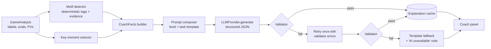

# AI Coach Design

| | |
|---|---|
| Status | Draft v0.2 — Phase 0, revised after owner review |
| Date | 2026-11-03 |
| Depends on | [CHESS_ANALYSIS_METHODOLOGY](CHESS_ANALYSIS_METHODOLOGY.md), [DATA_MODELS](DATA_MODELS.md) |

---

## 1. Purpose and guardrails

The coach turns **verified engine facts** into explanations a human can learn from. It is the main differentiator, and also the main source of risk, because LLMs write confident, fluent prose about chess that is often wrong.

**Hard rules**

1. The LLM never evaluates a position, chooses a best move, assigns a label, or produces a number that the UI displays.
2. Every chess fact in a prompt is computed by code: engine evaluations, PVs in SAN, material, and motif tags with evidence.
3. Every LLM output is schema-validated and **reference-checked**. Moves are referenced only by **identifiers from a supplied move catalogue**, never as free-text notation (§7).
4. Numbers (evaluations, percentages, accuracy) are rendered by the UI from engine data, never taken from model prose.
5. The AI is optional. Without a key, the coach panel shows **template explanations** generated deterministically from the same facts (§9).

## 2. Pipeline



## 3. Inputs: `CoachFacts`

The LLM receives a compact JSON document. It never receives raw UCI output, and never free-text PGN comments or headers (both are untrusted input and a prompt-injection vector).

```json
{
  "task": "explain_move",
  "level": "intermediate",
  "game": {
    "playerColor": "black",
    "opening": { "eco": "C50", "name": "Italian Game" },
    "timeClass": "blitz",
    "result": "1-0",
    "movesSan": ["e4","e5","Nf3","Nc6","Bc4","Nd4", "..."]
  },
  "moment": {
    "ply": 22, "moveNumber": 11, "mover": "black",
    "fenBefore": "r1bq1rk1/ppp2ppp/2n5/3np3/2B5/2NP1N2/PPP2PPP/R2Q1RK1 b - - 1 11",
    "label": "Blunder",
    "evalBefore": "+0.20",
    "materialBefore": { "white": 39, "black": 39 },
    "materialAfterRefutation": { "white": 39, "black": 36 },
    "phase": "middlegame",
    "clock": { "moverSecondsLeft": 14, "initialSeconds": 180 },
    "motifs": [
      { "id": "fork", "side": "white", "moveId": "R3", "targets": ["f7", "h7"], "confidence": "high" },
      { "id": "time_trouble", "side": "black", "confidence": "high" }
    ]
  },
  "moveCatalog": [
    { "id": "P",  "san": "Nxc3", "role": "played",         "by": "black", "evalAfter": "+3.10" },
    { "id": "B1", "san": "Be6",  "role": "best",           "by": "black", "evalAfter": "+0.20" },
    { "id": "B2", "san": "Re1",  "role": "best_line",      "by": "white" },
    { "id": "B3", "san": "f6",   "role": "best_line",      "by": "black" },
    { "id": "A1", "san": "Nb6",  "role": "second_best",    "by": "black", "evalAfter": "+0.45" },
    { "id": "R1", "san": "bxc3", "role": "refutation",     "by": "white" },
    { "id": "R2", "san": "Qf6",  "role": "refutation",     "by": "black" },
    { "id": "R3", "san": "Ng5",  "role": "refutation",     "by": "white" }
  ]
}
```

Notes:

- Evaluations are passed as **pre-formatted strings** for context only. The model is told never to quote them, and the validator checks that it doesn't.
- Player names are replaced with "you" and "your opponent" by default (privacy, and fewer distractions).
- **`moveCatalog` is the closed set of moves the output may reference.** It is built by code from engine PVs and the game record, and every entry is replayed with chess.js when it is built, so every catalogue move is legal by construction. The line ids are sequential (`B1` is the best move, `B2` the reply, and so on), which gives the model the order of each line. SAN is included so the model can understand the moves. The model must still refer to them by `id`.
- The ids follow a fixed grammar per task:
  - `explain_move`: `P` for the played move, `B1…Bn` for the best line, `A1` for the second-best move, `R1…Rn` for the refutation line.
  - `summarize_game`: `k<ply>.P`, `k<ply>.B1` for each key moment.

## 4. Deterministic motif detection (`core/motifs`)

Pattern detection belongs in code. Each detector returns a tag **with evidence** (squares, the move, the PV ply), or nothing.

| Motif id | Detection rule (summary) | Phase |
|---|---|---|
| `hanging_piece` | After the played move, a mover piece has SEE < 0, and the opponent's PV captures it within 2 plies | P1 |
| `missed_capture` | `best1` is a capture, and the PV nets ≥ 2 points of material within 6 plies | P1 |
| `allowed_mate` / `missed_mate` | From the mate rules in the methodology (mate allowed / mate lost), including mate distance | P1 |
| `fork` / `missed_fork` | In the refutation (or best) PV, a move attacks ≥ 2 enemy pieces worth more than the attacker, or king + piece, and material changes hands within 4 plies | P1 |
| `back_rank` | A mating PV whose final move is on the back rank, with the king's escape squares blocked by its own pawns | P2 |
| `pin` / `skewer` | Line-piece geometry: a valuable piece is behind the attacked piece on the same ray, and the PV exploits it | P2 |
| `promotion` | The PV contains a promotion that decides the evaluation swing | P2 |
| `king_safety` | Pawn-shield moves in front of a castled king, or a king left uncastled after move 12 with central files open, followed by a ≥ 10 Win% drop within 6 plies | P2 |
| `time_trouble` | Mover has < 10% of initial time, or < 20 s, when making a Mistake or worse (needs `%clk`) | P1 |
| `opening_deviation` | First non-book move that loses ≥ 5 Win% | P1 |

Each detector has unit tests with positive and negative fixture positions. A detector that cannot run (e.g. no PV) emits nothing. It never guesses.

## 5. Provider abstraction

The proposed single `ChessCoach` interface mixes **domain** (chess coaching) with **transport** (talking to a vendor). Splitting them makes each provider adapter tiny and lets the domain logic be tested without network access.

```ts
// infra/llm — transport, vendor-specific, ~100 lines per adapter
export interface LLMProvider {
  readonly id: "gemini" | "claude" | "openai";
  generate<T>(req: GenerateRequest<T>, signal?: AbortSignal): Promise<GenerateResult<T>>;
}

export interface GenerateRequest<T> {
  model: string;
  system: string;
  user: string;                 // JSON-serialised CoachFacts + task instructions
  schema: z.ZodType<T>;         // converted to JSON Schema for the vendor
  schemaName: string;
  maxOutputTokens: number;
  temperature: number;          // low (0.2–0.4) for factual tasks
  timeoutMs: number;
}

export interface GenerateResult<T> {
  data: T;                      // already parsed by Zod
  usage: { inputTokens: number; outputTokens: number };
  model: string;
  latencyMs: number;
}

// app/coach — domain, provider-agnostic
export interface ChessCoach {
  explainMove(input: MoveCoachInput, level: CoachLevel): Promise<CoachResult<MoveExplanation>>;
  summarizeGame(input: GameCoachInput, level: CoachLevel): Promise<CoachResult<GameSummary>>;
  describePatterns(input: PatternReport, level: CoachLevel): Promise<CoachResult<PatternNarrative>>;
  generateTrainingPlan(input: PatternReport): Promise<CoachResult<TrainingPlan>>;
}

export type CoachResult<T> =
  | { ok: true; value: T; source: "llm"; usage: TokenUsage; cached: boolean }
  | { ok: true; value: T; source: "template"; reason: CoachFallbackReason }
  | { ok: false; error: CoachError };
```

### 5.1 Vendor adapters

**Implementation scope:** Phase 4 implements the **Gemini adapter only**. The `LLMProvider` interface, the `provider` fields in stored records and the settings model stay provider-independent from day one. The Claude and OpenAI adapters are **deferred** until the Gemini coach has passed its Phase 4 exit criteria and the prompts, schemas and validator are stable (roadmap Phase 4b). This keeps the first round of prompt tuning to a single provider's behaviour.

| Provider | Status | Structured-output mechanism | Browser access | Notes |
|---|---|---|---|---|
| Gemini | **Phase 4** | `responseMimeType: "application/json"` + response schema | API key works from the browser | Free tier suits personal use; verify current free-tier limits and model IDs at implementation time |
| Claude | Deferred (Phase 4b) | Forced tool use (a single tool whose input schema is ours), or native structured outputs | Requires the `anthropic-dangerous-direct-browser-access` header (SDK `dangerouslyAllowBrowser`) | Current models include `claude-haiku-5-5` and `claude-sonnet-5-5`. Re-check at Phase 4b. |
| OpenAI | Deferred (Phase 4b) | JSON Schema response format in strict mode | SDK `dangerouslyAllowBrowser: true` | Pick a current small model at Phase 4b |

To keep Phase 4b cheap, the following are written provider-independently in Phase 4: the adapter contract tests (§14), the `LLMProvider` mock, and the error taxonomy (`auth`, `rate_limit`, `timeout`, `bad_response`, `network`).

- Model IDs live in a user-editable list, with no hardcoded assumptions beyond defaults.
- The SDKs are lazily imported, so unused providers add no bundle weight.
- JSON Schemas are generated from the Zod schemas (Zod 4 has a built-in JSON-Schema export). Output is **always** re-validated with Zod, even when the vendor promises schema conformance.

### 5.2 Reliability

| Concern | Policy |
|---|---|
| Timeouts | Move explanation: 30 s. Game summary / training plan: 60 s. Enforced with `AbortController`. |
| Retries | Network errors, 429, 5xx: up to 2 retries with exponential backoff and jitter (1 s, 3 s), honouring `Retry-After`. **No retry** on 400/401/403: show "check your API key / model". |
| Validation failure | One corrective retry that includes the validator's error list. Then the template fallback. |
| Concurrency | At most 2 in-flight requests. Key-moment explanations are queued in order of importance. |
| Cancellation | Navigating away from a game aborts its pending requests. |
| Token tracking | Store `usage` per call. Show a running total per session and per month. The cost estimate uses a **user-editable** price table (prices change; never hardcode them as truth). |
| Caching | Key = `hash(promptVersion, provider, model, level, task, factsHash)`. Re-opening a game makes no new calls. |

## 6. Output schemas

Prose fields are **CoachText**: plain text that may contain two kinds of inline reference token. Nothing else in the text counts as a reference.

| Token | Meaning | Example | Rendered as |
|---|---|---|---|
| `[[m:<moveId>]]` | A move from `moveCatalog` | `[[m:R3]]` | A clickable SAN chip with its move number ("13. Ng5"), which plays the move on the board |
| `[[sq:<square>]]` | A board square, `a1`–`h8` | `[[sq:f7]]` | The square name, highlighted on the board when hovered |

```ts
const MoveId = z.string().regex(/^(P|[BR][1-9]\d?|A1|k\d{1,3}\.(P|B1))$/);
const CoachText = (max: number) => z.string().max(max);          // tokens checked by the validator (§7)

const MoveExplanation = z.object({
  headline: CoachText(120),                     // "[[m:P]] lets White fork [[sq:f7]] and [[sq:h7]]"
  whatHappened: CoachText(700),
  whyBestIsBetter: CoachText(700).optional(),
  keyIdea: CoachText(240),                      // a transferable lesson
  keyMoves: z.array(z.object({                  // structured references, not extracted from prose
    moveId: MoveId,
    role: z.enum(["mistake", "best", "punishment", "alternative"]),
  })).max(6),
  motifIdsUsed: z.array(z.string()).max(5),     // must be ⊆ supplied motif ids
});

const GameSummary = z.object({
  overview: z.string().max(800),
  strongestMoments: z.array(Moment).max(3),
  biggestMistakes: z.array(Moment).max(3),
  turningPoints: z.array(Moment).max(3),
  phases: z.object({ opening: PhaseNote, middlegame: PhaseNote, endgame: PhaseNote }).partial(),
  improvements: z.array(z.object({ title: z.string().max(80), detail: z.string().max(300) })).length(3),
});
const Moment = z.object({ ply: z.number().int(), note: z.string().max(300) }); // ply must exist in supplied key moments
const PhaseNote = z.object({ note: z.string().max(400) });
```

## 7. Validator (`core/coach/validate.ts`)

### 7.1 Why not extract SAN from prose

The first draft extracted anything SAN-like from the prose with a regex and checked it against an allowed list. That approach has two flaws:

- **False positives.** A pawn move in SAN (`f7`, `c3`) is written exactly like a square. A sentence such as "the knight forks f7 and h7" would be read as the moves `f7` and `h7`, and rejected.
- **False negatives.** Prose can describe a move without valid notation ("take the pawn with the knight"), and no regex can map that to a specific move.

The fix is to make references **structured and explicit**. Moves are referenced only by catalogue id, and squares only by square token. Free-text notation is then something to *detect and reject*, not something to *interpret*.

### 7.2 Checks, in order

1. **Schema:** Zod parse of the vendor's JSON. Truncated or non-JSON output fails here.
2. **Token parsing:** in every `CoachText` field, find all `[[…]]` tokens.
   - A malformed token (unknown kind, bad syntax, unclosed brackets) → reject.
   - `[[m:ID]]` → `ID` must exist in this request's `moveCatalog`.
   - `[[sq:X]]` → `X` must match `^[a-h][1-8]$`. This is a syntax check only (see §7.3).
3. **Structured references:** every `keyMoves[].moveId` must exist in the catalogue, and its `role` must be consistent with the catalogue entry's role:
   - `mistake` ↔ `played`
   - `best` ↔ `best`
   - `punishment` ↔ `refutation`
   - `alternative` ↔ `second_best`, or a `best_line` entry other than the first.
4. **Untokenised move notation.** All `[[…]]` tokens are removed first, then the remaining text is scanned for notation that can **only** be a move, never a bare square. Any match → reject ("write moves as `[[m:…]]` tokens"). These patterns can only be moves:
   - castling: `O-O`, `O-O-O`, `0-0`, `0-0-0`;
   - piece moves: `[KQRBN][a-h]?[1-8]?x?[a-h][1-8]` followed by an optional `+` or `#`;
   - pawn captures: `[a-h]x[a-h][1-8]`;
   - promotions: `[a-h][18]=?[QRBN]`, and the capture form `[a-h]x[a-h][18]=?[QRBN]`;
   - any square followed by `+` or `#`;
   - move-number notation: `\d+\.(\.\.)?\s*\S+`, such as `12.Nf3` or `12...e5`.

   All of these patterns are anchored on word boundaries. A **bare square** such as `f7` is *not* matched, so mentioning squares never causes a false positive.
5. **Bare pawn moves (heuristic).** A pawn push written as a bare square ("you should play e5") can't be told apart from a square syntactically. Instead, the validator rejects a bare square directly after a move verb (`play`, `played`, `playing`, `push`, `pushed`, `advance`, `move to`, `answer with`, `respond with`), and asks for a `[[m:…]]` token. This is a heuristic and is documented as such (§7.3).
6. **Ply references:** every `ply` in a summary must be one of the supplied key moments.
7. **No evaluation numbers:** after removing tokens, reject prose that matches evaluation-like patterns: `[+-]?\d+\.\d{1,2}`, `\d+(\.\d+)? ?%`, `centipawn`, `\bcp\b`, `accuracy of \d+`, or `mate in \d+` when it isn't in the facts. Squares (`f7`) and move numbers ("move 23") don't match these patterns.
8. **Motif references:** `motifIdsUsed` must be a subset of the supplied motif ids.
9. **Label consistency:** a small, deliberately lenient keyword check that the prose doesn't contradict the computed label (e.g. "great move" for a Blunder).
10. **Length and level:** Beginner explanations over the vocabulary budget get a warning only, never a rejection.

A failure in any of checks 1–9 triggers the single corrective retry, with the validator messages included. A second failure produces the template fallback (§9).

The test fixtures include adversarial outputs that **must** be rejected:
- an invented move id;
- an invented move written as SAN text (`Qxf7#`);
- castling in prose;
- `12...e5`;
- "play e5";
- a made-up evaluation;
- a percentage;
- a malformed token;
- a `keyMoves` role mismatch;
- an unknown motif.

They also include outputs that **must** be accepted: square-heavy prose ("the f7 and h7 pawns", "the c3 knight"), move numbers, and tokens adjacent to punctuation.

### 7.3 What validation does and does not guarantee

**Guaranteed** (for any output the UI shows as AI text):
- It parsed against the schema.
- Every move the UI renders as a move comes from the engine-derived catalogue, so it is legal and really appears in the analysed lines.
- No unambiguous move notation appears outside tokens.
- No evaluation-style numbers appear in the prose. All numbers come from the engine data and are rendered by the UI.

**Not guaranteed.** These are the remaining limitations:
1. **Chess-semantic correctness.** A valid token can be described wrongly. "[[m:R3]] attacks your queen" passes even if Ng5 doesn't attack the queen. Syntactic validation cannot detect a false claim about the position.
2. **Square claims.** `[[sq:…]]` is checked for syntax only. Statements about which piece stands on a square, or what attacks it, are not verified.
3. **Bare pawn moves.** The verb heuristic catches the common phrasings, but not every possible one ("e5 was the way"). A plain square in prose is always treated as a square.
4. **Moves described in words** ("take with the knight") without a token can't be detected at all.
5. **Label consistency** is checked only for crude contradictions.

**Mitigations for the residual risk** (they reduce it, they don't remove it):
- Supplying motif evidence (squares, targets) so the model has correct facts to restate.
- A low temperature.
- A prompt rule to explain only through the supplied motifs and lines.
- Clickable move chips, so the user can see each move on the board and spot a wrong description.
- AI text labelled as an interpretation, with the engine lines shown beside it.
- Golden-set human ratings (§14).

**Possible later check, not in MVP scope:** check square tokens against the facts. For example, flag a sentence that pairs a piece name with a square that piece doesn't occupy in `fenBefore` or after the referenced move.

## 8. Coaching levels

| Level | Default for rating | Style instructions given to the model |
|---|---|---|
| Beginner | < 1000 | Short sentences. Name the tactic in plain words ("your knight could be taken for free"). One idea per explanation. Define any chess term the first time it is used. |
| Intermediate | 1000–1800 | Threats, piece activity, weak squares. Explain the opponent's idea behind the refutation. Mention the alternative move and why it holds. |
| Advanced | > 1800 | Discuss the supplied variations, positional trade-offs (structure, initiative, king safety), and long-term plans. Still limited to the supplied lines. |

The level changes **wording only**. The facts and the move catalogue are identical across levels.

### 8.1 System prompt (draft)

```
You are a chess coach explaining a game to the player who played it.
You are given verified analysis from the Stockfish engine as JSON.
Rules:
- Treat the JSON as the only source of truth. Do not analyse the position yourself.
- Refer to a move ONLY as [[m:ID]] using an id from "moveCatalog". Never write move
  notation (like Nf3, exd5, O-O or "play e5") as plain text. Do not refer to moves
  that are not in the catalogue.
- Refer to a square as [[sq:e4]].
- Never state evaluations, percentages or accuracy numbers; the app shows those.
- Use the supplied motifs to explain why; if no motif is supplied, explain using the
  best line and the refutation line only. If something is unclear, say less, not more.
- Write for the requested level: {levelInstructions}
- Speak to the player as "you". Be encouraging but honest.
Return only JSON matching the provided schema.
```

## 9. Template fallback (no AI key, or AI failure)

A deterministic explanation is built from the same facts. Example for a Blunder with a `fork` motif:

> **Nxc3 was a blunder.** The engine's best move was **Be6**. After Nxc3, your opponent can play **bxc3** and then **Ng5**, attacking f7 and h7 at the same time (a fork).

Templates are written in the same `CoachText` token format (`[[m:B1]]`, `[[sq:f7]]`), so AI text and template text go through one renderer. They are built only from catalogue entries and motif evidence, so they are correct by construction, but narrow.

This guarantees the coach panel is useful offline and for free. The AI layer then makes the explanation richer, but correctness doesn't depend on it.

## 10. Key-moment selection

The selection is automatic and deterministic, for the summary and for proactive per-move explanations:

1. Candidates are the player's moves labelled Blunder, Miss, Mistake, Brilliant or Great, plus the **turning point**: the ply with the largest single Win% swing that crosses 50 (the result changing hands).
   Exact rule (decision M13, implemented in Phase 3 in `core/review`): over the moves where both White-POV Win% values exist, a move crosses 50 when `(w[i] − 50) × (w[i+1] − 50) < 0`; exactly 50 is not a crossing. The turning point is the crossing move with the largest `|w[i+1] − w[i]|`, the earliest on a tie. There is none if no move crosses 50. It is shown only for complete analyses.
2. Rank them by Win% swing (Brilliant and Great are ranked by `gap`).
3. Take up to 6 for the player and up to 2 for the opponent (critical opponent errors the player failed to punish are already covered by Miss).
4. Make sure each phase that has a candidate is represented at least once.

Other moves are explained only when the user asks.

## 11. Recurring-weakness detection

This is code first. The LLM only narrates.

1. **Aggregate** motif tags and labels across all stored analyses of the user's games (`core/stats`). Track: count, number of distinct games, rate per game, rate per 100 moves, and the phase and time class split.
2. **Gate on evidence.** A claim's confidence level determines whether it can be shown:

| Level | Requirement | Shown as |
|---|---|---|
| Insufficient | Fewer than 10 analysed games total, or the motif seen in fewer than 3 games | Not shown (the UI says "analyse N more games") |
| Emerging | At least 10 games, motif in at least 3 games and at least 5 occurrences | "Possible pattern", with links to evidence |
| Established | At least 25 games, motif in at least 8 games, and the Wilson 90% lower bound of the per-game rate ≥ 0.15 | "Recurring weakness" |

3. Every claim carries **evidence**: a list of `(gameId, ply)` the user can click through.
4. **Comparisons over time** (improving / worsening) need at least 10 games in each compared window. Otherwise we show the counts without trend wording.
5. The LLM receives only claims at Emerging or Established, with their counts, and writes the narrative (`PatternNarrative`). It cannot add patterns: the validator checks that every motif mentioned is in the supplied list.

Time management is analysed only for games that have `%clk` data, and the gating counts only those games.

## 12. Personalised training plan

Drill sources, all grounded in stored data:

| Drill type | Source | Example |
|---|---|---|
| **Retry your mistake** | The mistake library (the user's own positions), scheduled with simple spaced repetition (correct → interval ×2; wrong → reset) | "Find the move you missed against X on 12 Oct" |
| **Themed external practice** | Map motif → Lichess puzzle theme URL (e.g. `fork`, `hangingPiece`, `backRankMate`, `mateIn2`) | "10 fork puzzles" (link only, no scraping) |
| **Opening repair** | `opening_deviation` positions where the user leaves theory and loses ≥ 5 Win%, repeated across games | "In the Italian with Black you play …Nd4 early. Review the main line." |
| **Endgame focus** | Endgame-phase accuracy compared with the player's other phases (gated as in §11) | "Rook endgames: practise the Lucena and Philidor positions" |

The LLM's job is to **prioritise and phrase** a plan of 3–5 items from a supplied list of candidate drills. The schema requires each item to reference a candidate drill id. Ids that don't exist are rejected.

## 13. Privacy and transparency

- Before the first AI call, the user sees an example of exactly what is sent (a `CoachFacts` document) and which provider receives it.
- Sent: moves, positions, our computed facts. Not sent: usernames (unless enabled), PGN headers, comments, other games.
- The API key is never included in prompts, logs or exports.

## 14. Evaluating the coach

- **Golden set:** about 30 fixed `CoachFacts` moments covering each label, motif and level.
- **Automated checks per provider/model** (Gemini only in Phase 4):
  - validator pass rate on the first try (target ≥ 95%);
  - the reasons for rejection, broken down by check;
  - latency;
  - tokens.

  After validation, the rate of moves from outside the catalogue reaching the UI is 0 by construction. Instead, this harness measures how often the model *tries* to produce such references.
- **Semantic accuracy, by hand:** for each golden moment, the owner marks every factual claim in the explanation as correct or incorrect against the engine lines. The **incorrect-claim rate** is the metric for the risk that validation can't cover (§7.3).
- **Usefulness spot check:** the owner rates 10 explanations per release for usefulness (1–5). These ratings and the incorrect-claim rate are tracked over time, which turns prompt changes into measurable experiments.
- Prompts are versioned (`promptVersion`). A change re-runs the golden set before release.
