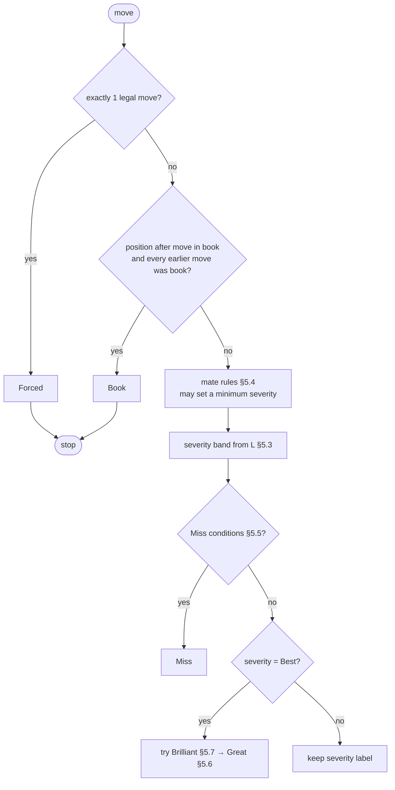

# Chess Analysis Methodology

| | |
|---|---|
| Status | Methodology **v1.0.0** — clarified before implementation (2026-11-13, Phase 3 Stage 0); implemented in Phase 3 |
| Date | 2026-11-03, revised 2026-11-13 |
| Principle | Every number shown to the user is produced by the rules in this document, from Stockfish output. Nothing is estimated by an LLM. |

This document is the contract for `core/eval`, `core/classify`, `core/accuracy` and `core/phases`. Every constant here lives in one versioned config object (`methodology.v1.ts`). Changing any value bumps `methodologyVersion`.

---

## 0. Compatibility statement

This methodology has three kinds of rules, and the app's "About this analysis" panel states which is which.

| Part | Status | Details |
|---|---|---|
| Win% curve, centipawn ceiling, mate → Win% mapping | **Lichess-compatible**: same formula and constants | §4 |
| Move accuracy formula, including the +1 uncertainty bonus and clamping | **Lichess-compatible** | §6.1 |
| Game accuracy: volatility weights, sliding windows, weighted mean, harmonic mean, missing-eval handling | **Lichess-compatible** in `lichessCompat` mode. The default mode differs in exactly one rule: Forced moves are excluded (§6.3). | §6.2–6.4 |
| ACPL | **Same definition as Lichess's ACPL**, verified in our tests against Lichess's reported ACPL (±1 on the 50 cross-check games). This is an internal validation, **not** part of the user-facing compatibility statement (decision B3, Phase 3). | §6.6 |
| Move labels and their thresholds (bands, Miss, Great, Brilliant, Book, Forced) | **Our own.** The mate rules borrow Lichess's boundaries, but the labels are our design. | §5 |
| Phase boundaries, and so phase accuracy | **Our own.** The divider differs from Lichess's, so phase accuracies are *not* comparable with Lichess's. | §7 |
| Anything from Chess.com | **No relationship.** Chess.com's accuracy and classification are proprietary. We neither reproduce nor approximate them, and no formula is ever tuned to resemble Chess.com's numbers. | §6.7 |

"Compatible" has a precise meaning here: **given the same per-position evaluations**, our code produces the same numbers as Lichess's code, within rounding. It does *not* mean our numbers will match the Lichess website for the same game, because the engine, its version and its search budget all differ.

---

## 1. Four different things — do not mix them up

| Concept | Unit | Source | Example |
|---|---|---|---|
| **Engine evaluation** | centipawns (cp) or "mate in N" | Stockfish | `+0.85`, `M4`, `−M2` |
| **Win percentage (Win%)** | 0–100, from one side's point of view | Our formula, applied to the evaluation | 57.7% |
| **Move accuracy** | 0–100 | Our formula, applied to the Win% before and after a move | 81 |
| **Game accuracy** | 0–100 | Aggregate of move accuracies (§6) | 87.4 |

A **move label** (Best, Mistake…) is derived from Win% loss plus contextual rules (§5). Labels and accuracy are computed **independently** from the same inputs. Neither is derived from the other.

## 2. Representing scores and perspective

### 2.1 Score type

```ts
type Score =
  | { kind: "cp"; value: number }          // centipawns, WHITE perspective
  | { kind: "mate"; moves: number }        // ≠ 0; >0 White mates in n, <0 Black mates in n
  | { kind: "terminal"; result: "1-0" | "0-1" | "1/2-1/2" }; // game over on the board
```

`mate 0` never appears. A position where the side to move is checkmated is `terminal`, with the winner known from the rules, not from the engine.

### 2.2 Normalisation, in exactly one place

UCI reports `score` from the **side to move's** perspective. The UCI parser converts it to **White's** perspective immediately:

```
whiteScore = (sideToMove === "w") ? uciScore : −uciScore     // applies to cp and to mate N
```

Everything stored and passed around is White-perspective. When a calculation needs the **mover's** perspective (the player who just made the move being judged), it uses one helper:

```
povScore(score, color) = color === "w" ? score : negate(score)
```

Test invariant: mirroring the board and swapping colours must produce identical labels and accuracies (see [TESTING_STRATEGY](TESTING_STRATEGY.md) §4.2).

### 2.3 Lower/upper bound lines
`info … score cp X lowerbound|upperbound` lines are aspiration-window bounds, not final scores, and are discarded. We take the last exact score from the deepest completed iteration for each `multipv` index.

## 3. Positions the engine does not evaluate

| Board state (detected by chess.js) | Score assigned |
|---|---|
| Side to move is checkmated | `terminal`, with the winning side |
| Stalemate | `terminal 1/2-1/2` |
| Insufficient material, under FIDE dead-position rules as implemented by chess.js. This is narrower than Chess.com, which also ends K+N vs K+N as "insufficient material" even though a helpmate exists. Such a position is evaluated by the engine normally (≈ 0.00). | `terminal 1/2-1/2` |
| Threefold repetition (from move history) | `terminal 1/2-1/2` |
| 50-move rule reached | `terminal 1/2-1/2` |
| Game ended by resignation, timeout, or draw agreement | **Not** terminal. The final position is evaluated normally. |

**Only the game's final position can be terminal (decision D6, Phase 2).**
- Checkmate, stalemate and insufficient material end the game on the spot, so they can only occur at the end.
- A threefold repetition or 50-move position is only a *claimable* draw. If the players continued, it wasn't the end of the game: later positions are real and are analysed by the engine as normal. The engine still receives the full move history, so it scores a repetition correctly.
- Code: `terminalScore` in `src/core/engine/jobs.ts`.

## 4. From evaluation to Win%

### 4.1 Formula (v1)

We use the **published Lichess curve**, a logistic function fitted by Lichess to large numbers of real games:

```
Win%(cp) = 50 + 50 · ( 2 / (1 + e^(−0.00368208 · cp)) − 1 )      ≡ 100 / (1 + e^(−0.00368208 · cp))
```

with:

- `cp` clamped to **[−1000, +1000]** before applying the formula (the Lichess "ceiling");
- `mate` for the side → treated as **+1000** (Win% ≈ 97.5); `mate` against → **−1000** (≈ 2.5);
- `terminal` win → +1000; loss → −1000; draw → 0 (Win% = 50).

How this corresponds to the Lichess source (scalachess `WinPercent`, lila `forceAsCp`):

| Our score | Lichess representation | Lichess conversion | Win% |
|---|---|---|---|
| `cp` | `Score.Cp` | `fromCentiPawns(cp.ceiled)` | curve |
| `mate +n` (mover mates) | `Score.Mate(+n)` | `forceAsCp` → `Int.MaxValue − n` → ceiled to +1000 | 97.54 |
| `mate −n` (mover is mated) | `Score.Mate(−n)` | → ceiled to −1000 | 2.46 |
| `terminal` with the side to move checkmated | `Mate(0)` for the mated side; `MateGiven` for the winner | −1000 / +1000 | 2.46 / 97.54 |
| `terminal` draw | No dedicated Lichess representation | **Our rule:** cp 0 | 50 |

The terminal-draw row is our choice. Lichess's code doesn't define it, so no compatibility claim is made for it.

Reference values:

| cp (mover POV) | 0 | +50 | +100 | +150 | +200 | +300 | +500 | +800 | ≥ +1000 / mate |
|---|---|---|---|---|---|---|---|---|---|
| Win% | 50.0 | 54.6 | 59.1 | 63.5 | 67.6 | 75.1 | 86.3 | 95.0 | 97.5 |

(Symmetric: Win%(−cp) = 100 − Win%(cp).)

### 4.2 Why this curve
- **Recommend:** Use the Lichess logistic curve for v1.
- **Why:**
  - It is public and documented.
  - It is fitted to human games.
  - It makes losing 300 cp count for much more at 0.00 than at +8.00, which raw centipawn loss doesn't.
  - It lets us validate our implementation exactly against Lichess's reported numbers (testing §4.5).
- **Alternatives considered:**
  - **Raw centipawn loss (ACPL).** It over-punishes small inaccuracies in decided positions, and a mate has no natural centipawn value. We keep it as a secondary statistic only.
  - **Stockfish's WDL model (`UCI_ShowWDL`).** It is calibrated on engine self-play, which is very drawish, so it would make many human mistakes look tiny. We record WDL for future research but don't score with it.
  - **A rating-aware curve** (Chess.com's Expected Points model reportedly depends on player rating). This is more personal but needs fitted data we don't have. We list it as a future option (unresolved decision U3).
- **Trade-off:** The ceiling means mate-in-2 and +12.00 look the same (97.5%). The dedicated mate rules in §5.4 cover the cases where that matters.

## 5. Move classification

### 5.1 Inputs per move

For the move from position *P* (before) to *P′* (after), played by colour *c*:

| Symbol | Meaning |
|---|---|
| `Wb` | Win% for *c* at *P*: engine eval of *P* (best play), from *c*'s POV |
| `Wa` | Win% for *c* at *P′*: engine eval of *P′* after the **played** move, from *c*'s POV |
| `L` | Win% loss = `max(0, Wb − Wa)` |
| `best1`, `best2` | Top two engine moves at *P* (MultiPV 1 and 2) with their Win% for *c*. **The move `best1` is the engine's reported `bestmove`** (decision D16). Its Win% comes from the last exact top line (`lines[0]`). When a node-limited search is cut short these two can name different moves. That is normal Stockfish behaviour (architecture §6.1 notes). |
| `gap` | `Win%(best1) − Win%(best2)` (only when MultiPV ≥ 2 and ≥ 2 legal moves) |
| `Wprev` | Win% for *c* at the position before the opponent's previous move |

`Wb` and `Wa` come from two separate searches, so `Wb − Wa` can be slightly negative for the best move. This is search noise, and it is clamped at 0.

### 5.2 Evaluation order

Rules are applied as a pipeline. Each step can set the label or stop the pipeline.



**Missing evaluations come first (§6.4).** If the evaluation of *P* or *P′* is missing, the move gets **no label at all**, not even Forced or Book, and the reason `missing:eval` (decision M6). Forced and Book need no evaluation, but §6.4 leaves the move ungraded, and the UI says why.

### 5.3 Severity bands (base labels)

| Label | Condition (mover's Win% loss `L`) | Notes |
|---|---|---|
| **Best** | played move = `best1`, **or** `L ≤ 0.5` | The tolerance absorbs search noise and genuinely equal moves |
| **Excellent** | `0.5 < L < 2` | |
| **Good** | `2 ≤ L < 5` | |
| **Inaccuracy** | `5 ≤ L < 10` | |
| **Mistake** | `10 ≤ L < 20` | |
| **Blunder** | `L ≥ 20` | |

**Why these bands:**
- Chess.com's help centre describes its bands as expected-points loss of 0.02 / 0.05 / 0.10 / 0.20. We use the same *shape* on our own Win% scale, so the labels feel familiar.
- Because our curve differs from theirs, **our labels are not equivalent to Chess.com's** and must never be presented as such.
- Lichess uses 5 / 10 / 15 on the same Win% scale. Its blunder band starts at 15 rather than our 20.
- All thresholds live in the config, so this choice is easy to revisit after testing on the owner's games (unresolved decision U2).

What the bands mean in practice (equal position, mover POV):

| Before → after | L | Label | Move accuracy |
|---|---|---|---|
| 0.00 → −1.00 (drops a pawn) | 9.1 | Inaccuracy | 67 |
| 0.00 → −2.00 (drops the exchange) | 17.6 | Mistake | 46 |
| 0.00 → −3.00 (drops a piece) | 25.1 | Blunder | 32 |
| +1.50 → −1.50 | 26.9 | Blunder | 30 |
| +8.00 → +5.00 (still winning) | 8.7 | Inaccuracy | 68 |
| −8.00 → −10.00 (already lost) | 2.5 | Good | 90 |
| +10.00 → 0.00 (throws the win away) | 47.5 | Blunder | 11 |

The curve deliberately goes easy on errors in positions that are already decided, and hard on errors that change the result.

### 5.4 Mate rules (boundaries taken from Lichess's advice logic)

`Win%` saturates at mate (§4.2), so mate-related transitions get explicit rules. These rules set a **minimum** severity, which is combined with §5.3 by taking the worse of the two. The conditions and boundaries match lila's `Advice.scala`. The labels they feed into are ours.

The three rules are mutually exclusive:

| Rule | Condition (mover POV) | Minimum severity |
|---|---|---|
| **Mate allowed** | *P* is a `cp` score (no forced mate for either side), **and** *P′* is a forced mate against the mover | Inaccuracy if cp at *P* ≤ −1000 (already lost); Mistake if −1000 < cp < −700; Blunder if cp ≥ −700 |
| **Mate lost** | *P* is a forced mate **for** the mover, **and** *P′* is not (a `cp` score or a mate against) | Inaccuracy if *P′* is cp ≥ +1000; Mistake if +700 < cp < +1000; Blunder if cp ≤ +700 **or** *P′* is a mate against the mover |
| **Mate delayed** | Mate for the mover at both *P* and *P′*, with a longer distance at *P′* | No minimum. Win% loss is 0, so the band gives Best or Excellent. |

A move that **delivers** checkmate makes *P′* `terminal` (a win for the mover), so none of these rules apply, and the band gives Best.

A **terminal draw** at *P′* (e.g. stalemating the opponent while having a forced mate) counts as `cp 0` for these rules, as in §4.1. So "Mate lost" applies with cp 0 ≤ +700 → Blunder (decision M7).

`cp` in this table is the mover-POV centipawn score of `lines[0]`, not clamped.

### 5.5 Miss

A **Miss** means the opponent's previous move gave the mover a clear opportunity, and the mover did not take it.

All of the following must hold:
1. The opponent's previous move was labelled Mistake or Blunder, **or** `Wb − Wprev ≥ 10` (the opportunity was handed over).
2. The mover's own move has severity **Mistake or Blunder** (`L ≥ 10`), or it triggered **Mate lost**.
3. `Wb ≥ 60`, so there really was something to take.

The label becomes **Miss**, and the underlying severity is kept in the data for statistics and accuracy.

Clarified (decision M8):
- Condition 1 uses the opponent's previous move's **severity**, so an opponent move that was itself labelled Miss still counts if its severity is Mistake or Blunder.
- If the opponent's previous move has no severity (ungraded, Book or Forced) and `Wprev` is unavailable (the first move of the game, or a missing evaluation), condition 1 can't be checked and the move is not a Miss.

### 5.6 Great (experimental)

A **Great** move is the only move that keeps the evaluation. It needs Standard or Deep analysis (MultiPV ≥ 2).

All of the following must hold:
1. The severity is Best and played move = `best1`.
2. There are at least 2 legal moves, and `best2` exists.
3. `gap ≥ 10`: the second-best move is clearly worse.
4. `5 ≤ Wb ≤ 95`: the position isn't already decided.
5. It is not an obvious recapture, meaning the move does not capture on the square where the opponent just captured. Obvious recaptures are often "only moves", but they are not notable.
6. It is not a king move out of check when there are at most 2 legal moves.

If MultiPV data is missing (Quick preset, or a failed search), Great is **not evaluated**. The move keeps its base label.

Clarified (decision M9):
- `best2` is `lines[1]`. If the engine's `bestMove` differs from `lines[0].pv[0]` (D16), `best1` and `best2` can't be told apart reliably, so Great is **not evaluated**.
- An **obvious recapture** (condition 5) is a capture whose destination square is the destination square of the opponent's previous move, when that previous move was itself a capture.

### 5.7 Brilliant (experimental)

A **Brilliant** move is a sound sacrifice that is also the best move. Losing material on its own is never enough. Like Great, it is evaluated only at the Standard and Deep presets. Quick-preset PVs are too shallow to check condition 3.

Material, the balance, SEE and the null-move position *P\** are defined in §5.11. The PV is `lines[0].pv` of *P′* (the opponent moves first).

All of the following must hold:
1. The move qualifies as Best, and is `best1` or within 1.0 Win% of it: `Win%(lines[0] at P) − Wa ≤ 1.0`, mover POV (decision M15).
2. **There is a real sacrifice: the sacrificed set S is not empty.** A mover's piece on square *q* is in S when SEE at *P′* on *q* is **≥ 2** and SEE is certain (§5.11), and:
   - for the **moved piece**: it was **not already lost before the move**, i.e. SEE at *P\** on its starting square is < 2. This excludes desperado moves. For a promotion, the moved piece is the new piece and its starting square is the pawn's (decision D3);
   - for **any other piece**: it was **not already losing ≥ 2 before the move**, i.e. SEE at *P\** on *q* is < 2 ("left undefended or newly exposed").
3. **The sacrifice is accepted and not immediately recovered** (decision D1):
   - **accepted:** the **first PV ply** (the opponent's reply) captures a piece in S;
   - **not recovered:** the mover's balance after **each** of PV plies 1, 2, 3 and 4 is ≤ (balance at *P*) − 2.
4. **The position after the move is not losing:** `Wa ≥ 50`.
5. **The position before wasn't already crushing:** `Wb < 90`. Sacrifices in won positions are cheap.
6. The PV contains at least 4 plies. Otherwise condition 3 can't be checked, and the label is omitted.

**Mate exception (decision D2).** If *P′*'s `lines[0]` score is a forced mate for the mover, condition 3 (acceptance **and** recovery) is waived, and so is condition 6. Conditions 1, 2, 4 and 5 must still hold, so S must contain a real sacrifice made by this move. A piece that was already hanging before the move never makes S non-empty, so an unrelated hanging piece can't create a Brilliant through this exception. Note that condition 5 normally blocks the exception: when the search at *P* already sees the mate, `Wb` = 97.5. The exception fires only when the search at *P′* finds a mate that the search at *P* did not.

**Not evaluated** (no Brilliant label, the move keeps its other label):
- the preset is Quick, or the analysis is not MultiPV ≥ 2;
- the mover is **in check at *P*** (decision D4), because *P\** is then not a legal position;
- *P′*'s engine `bestMove` differs from its `lines[0].pv[0]` (D16), so the PV is not certain;
- any SEE needed for condition 2 is **uncertain** (§5.11);
- any other condition can't be checked.

Brilliant takes precedence over Great.

**Known blind spots** (all lean towards no label): sacrifices accepted only after an in-between move; good sacrifices the engine's best reply declines (unless the mate exception applies); an attacked piece that sacrifices itself instead of retreating (excluded as a desperado); a sacrifice that gives check, so it can't be taken yet; deflection or interference sacrifices whose cost isn't visible on one square; material regained after PV ply 4 still counts as a sacrifice.

### 5.8 Book

A move is **Book** when:

- the position *after* the move (as an EPD: placement, side, castling, en-passant) appears in the bundled opening index; and
- every earlier position in the game (after each earlier move) also appears in the index.

The chain is about **positions**, not labels (decision M5): an in-book move that is the only legal move is labelled Forced (§5.2 order), but it doesn't break the chain.

The opening index is built from the Lichess `chess-openings` CC0 dataset (every position along every named line), pinned to commit `3ba6b20d31b2e6125cb0e6a2e792f400717d9d39` (2026-11-05). EPDs are computed with chess.js both when the index is built and at runtime, so the en passant field always follows the same rule. The pinned commit is part of the methodology config: changing it bumps the version.

**Opening name:** the name and ECO of the deepest position of the game, among positions 0..n, that is the end position of a named line. A game with no such position has no opening name. A name is never guessed.

Book moves are still engine-evaluated, and they are included in accuracy (their loss is normally ≈ 0).

### 5.9 Forced
A **Forced** move is the only legal move. It is not graded. By default it is excluded from game accuracy (§6.3). This is our one intentional difference from Lichess's aggregation: a forced move carries no information about the player and always scores ≈ 100.

### 5.10 Label configuration

```ts
// src/core/methodology/v1.ts. Frozen: changing any value breaks Lichess compatibility (§0).
export const LICHESS_ACCURACY_V1 = {
  winPercentK: 0.00368208, cpCeiling: 1000,
  accA: 103.1668100711649, accK: 0.04354415386753951, accB: -3.166924740191411, uncertaintyBonus: 1,
  windowDivisor: 10, windowMin: 2, windowMax: 8, weightMin: 0.5, weightMax: 12,
  harmonicFloor: 1, legacyInitialCp: 15,
} as const;

export const METHODOLOGY_V1 = {
  version: "1.0.0",
  accuracyMode: "default",                // "default" | "lichessCompat"; the app always uses "default"
  bands: { bestTolerance: 0.5, excellent: 2, good: 5, inaccuracy: 10, mistake: 20 },
  mate: { inaccuracyAtCp: 1000, mistakeBeyondCp: 700 },   // mirrored per rule, see §5.4
  miss: { opportunityGain: 10, minWinBefore: 60, minSeverity: "mistake" },
  great: { minGap: 10, minWb: 5, maxWb: 95, enabled: true },        // experimental flag
  brilliant: { minSacrifice: 2, minPersistPlies: 4, minWa: 50, maxWb: 90, bestWithin: 1.0, enabled: true }, // experimental flag
  material: { p: 1, n: 3, b: 3, r: 5, q: 9 },                       // §5.11
  phases: { minMovesForPhaseAccuracy: 6, openingMaxPieces: 10, backRankSparse: 4, bookGuardMoves: 12, endgameMaxPieces: 6 },
  openings: { source: "lichess-org/chess-openings", commit: "3ba6b20d31b2e6125cb0e6a2e792f400717d9d39" },
} as const;
```

The experimental flags (`great.enabled`, `brilliant.enabled`) are part of the config, so turning one off is a methodology change too.

The accuracy constants (`k`, `cpCeiling`, `uncertaintyBonus`, the window and weight limits in §6.2) are **Lichess-compatibility constants**. Changing any of them breaks the compatibility claim in §0, so they sit in a separate, frozen `LICHESS_ACCURACY_V1` object rather than in the label config.

### 5.11 Material, balance and SEE (used by Brilliant)

**Material.** Pawn 1, knight 3, bishop 3, rook 5, queen 9. Kings count 0. A promoted piece counts at its new value. The **balance** of a position is the mover's material minus the opponent's.

**Null-move position *P\**.** The position *P* with the side to move switched to the opponent and the en passant field cleared. It is only built when the mover is not in check at *P* (otherwise it isn't legal, and Brilliant is not evaluated).

**SEE is a deterministic least-valuable-attacker exchange estimate,** not an exact search. `see(position, square)` estimates the material, ≥ 0, that the side to move wins by starting a sequence of captures on the square, when either side may stop before any capture:

1. List the **legal** captures on the current target square in the **actual position** (chess.js), so pins, checks, king safety, en passant and promotion follow the rules. For en passant, the captured pawn stands on the target; the exchange then continues on the en passant destination square. No legal capture → the sequence ends.
2. Pick the **least valuable** capturer (pawn < knight = bishop < rook < queen < king). Ties are broken deterministically: knight before bishop, then the lowest starting square (a1, b1, …, h8).
3. The gain is the captured piece's value, **+8** if the capture promotes (always to a queen). Play the capture on the board and switch sides.
4. Fold the list of gains backwards so that each side stops when continuing would lose. The result is max(0, folded value). At most 32 captures are considered.

**Equal-value capturers can give different results.** Pieces of the same value stand on different squares, so which one captures first changes what is revealed behind it, e.g. a discovered check that makes the opponent's recapture illegal. The tie-break keeps the estimate deterministic, but it may differ from the result of the best order. To stay conservative, SEE also reports whether it is **certain**: at every step where more than one least-valuable capturer exists, each alternative is also played out, and if any alternative order changes the result the SEE is **uncertain**. Brilliant (§5.7) treats an uncertain SEE as "can't be checked" and gives no label.

**Limitations (documented, not bugs):** SEE is static. It looks only at captures on one square. It ignores in-between moves, checks elsewhere on the board, pins against non-king pieces, threats created by the exchange, and stalemate. It never replaces the engine: Brilliant always confirms acceptance and the material deficit along the engine's own PV (§5.7 condition 3).

## 6. Accuracy

### 6.1 Move accuracy

From the mover's Win% before (`Wb`) and after (`Wa`):

```
if Wa ≥ Wb:  accuracy = 100
else:        accuracy = clamp( 103.1668100711649 · e^(−0.04354415386753951 · (Wb − Wa)) − 3.166924740191411 + 1,  0, 100 )
```

The `+1` is the "uncertainty bonus" from Lichess's implementation, which compensates for imperfect analysis. Clamping happens **after** the bonus is added. `Wb` and `Wa` are both from the mover's perspective. In White-perspective terms, a Black move uses `Wb = 100 − w[i]` and `Wa = 100 − w[i+1]`. Lichess writes the same thing as `before = w[i+1]`, `after = w[i]`, which is identical because the curve is symmetric. Values:

| Win% loss | 0 | 0.5 | 1 | 2 | 5 | 10 | 15 | 20 | 30 | 50 |
|---|---|---|---|---|---|---|---|---|---|---|
| Move accuracy | 100 | 98.8 | 96.6 | 92.4 | 80.8 | 64.6 | 51.5 | 41.0 | 25.8 | 9.5 |

### 6.2 Game accuracy (per player)

This step-by-step definition re-implements lila's `AccuracyPercent.gameAccuracy`. It was checked line by line against the source on 2026-11-03.

**Input.** A White-perspective evaluation for each position `0..n`. Position 0 is the **initial position**, which the engine evaluates like any other (lila does the same, using `initialScore`). Positions without an evaluation are `missing`. `n` is the number of plies.

1. **Win% series:** `w[k] = Win%(score[k])` for k = 0..n (§4), or `missing`.
2. **Window size:** `ws = clamp( floor(n / 10), 2, 8 )`. Here `n` = number of positions − 1, the same as lila's `(cps.size − 1) / 10` with integer division.
3. **Windows**, one per move. Move *i* goes from position *i* to *i+1*, for i = 0..n−1.
   - Let `lead = min(ws, n+1) − 2`. The first `lead` moves all use the window `w[0 .. ws−1]`.
   - Every later move *i* uses the **trailing** window `w[i−ws+2 .. i+1]`, which ends at the position *after* the move.
   - Together these give exactly *n* windows, the same as lila's `List.fill(lead)(take(ws)) ::: sliding(ws)`.
   - If the series is shorter than `ws`, the single window is the whole series (Scala's `sliding` behaviour).
4. **Volatility weight** of move *i* = the **population** standard deviation (dividing by the count, not count − 1) of the Win% values in its window, clamped to **[0.5, 12]**. If **any** value in the window is `missing`, the weight is `missing`.
5. **Mover of move *i*:** White if `(i is even) == (startColor is White)`. `startColor` comes from the start FEN, so games that begin with Black to move are handled.
6. **Move accuracy** `acc_i` as in §6.1, computed from `w[i]` and `w[i+1]` from the mover's perspective. If either is `missing`, the move has no accuracy.
7. **A move counts towards its player's aggregate only if** it has both an accuracy and a weight.
8. For each player:
   - `weighted = Σ(acc_i · weight_i) / Σ(weight_i)`. Undefined if Σweight = 0.
   - `harmonic = m / Σ( 1 / max(1, acc_i) )`, where m is the number of counted moves. Each accuracy is **floored at 1** inside the reciprocal, exactly as scalalib's `harmonicMean` does, so a 0% move contributes 1/1 rather than infinity.
9. **Game accuracy = (weighted + harmonic) / 2.** It is undefined, and shown as "—", if the player has no counted moves.

Lichess displays this value rounded to an integer. We store the full-precision value and display one decimal place.

**Why this method:**
- Neither mean works well alone. The arithmetic mean lets one blunder hide among many book moves. The harmonic mean on its own is dominated by the worst moves.
- Volatility weighting makes moves in sharp, critical phases count more.
- The method is public, has been used on millions of games, and can be verified exactly (testing §4.5).

**Alternatives:** the arithmetic mean of move accuracies, or an ACPL-based score. Both are simpler to explain and less meaningful.

### 6.3 The one difference in default mode: Forced moves

| Mode | Forced moves | Used for |
|---|---|---|
| `lichessCompat` | Included like any other move | Verifying our implementation against Lichess (tests) |
| `default` (shown to the user) | Weights are still computed over the **full** series, so the windows are unchanged. Forced moves are then left out of step 8 for both the weighted and the harmonic mean. | Everything the user sees |

This is the only difference. Everything else in §6.1–6.2 is identical in both modes.

### 6.4 Missing evaluations

This follows the Lichess behaviour from §6.2, in both modes:

- A position that has no evaluation (because the engine failed after one retry) leaves the two adjacent moves without a move accuracy and without a label.
- It also leaves every move whose volatility window contains that position (up to `ws` moves) without a weight. Those moves keep their move accuracy and label, but they **don't count** towards game accuracy.
- The UI shows "N moves not included in accuracy (analysis unavailable)". No value is ever invented to fill the gap.

Failed positions should be rare, because the pool retries once (architecture §6.1). The testing strategy covers this path explicitly.

### 6.5 Phase accuracy
For each phase, take the positions where the position itself **or** the next position belongs to that phase (lila's slicing rule, which includes the boundary position). Then run §6.2 on that slice, with `startColor` = the side to move at the slice's first position. The result is shown only when the player has at least 6 counted moves in the phase.

The slice is run with the same accuracy mode and the same Forced flags as the whole game.

**Compatibility note:** the aggregation is Lichess's, but our phase **boundaries** (§7) are not, so phase accuracies are not comparable with Lichess's.

### 6.6 Secondary statistic: ACPL
Lichess-compatible (lila `AccuracyCP`): for each of the player's moves, take the White-perspective scores before and after, convert mates to ±∞ and clamp everything to ±1000. The loss is `max(0, (after − before) × (White ? −1 : +1))`. ACPL is the mean of these losses, rounded to the nearest integer, over moves where both scores exist. It is shown in advanced views only.

Clarified: ACPL counts **every** move with both scores, including Forced moves (Lichess has no Forced exclusion), and it is the same in both accuracy modes. A terminal win is ±1000 and a terminal draw is 0. ACPL is verified against Lichess (±1) as an internal validation, not a compatibility claim (§0).

### 6.7 What we deliberately do not compute
- **"Game rating" / estimated performance Elo.** There is no defensible method without a large calibration dataset. Omitted.
- **Chess.com-equivalent accuracy.** If Chess.com supplies `accuracies` in the game object, we may show it *next to* ours, labelled "Reported by Chess.com". We never relabel or blend it.

## 7. Game phases

The divider is inspired by Lichess's (published) approach, using material and development:

- **Opening → middlegame** starts at the first ply where any of these holds:
  - non-pawn, non-king pieces ≤ 10 in total;
  - the back ranks are sparse (fewer than 4 of a side's own pieces on its first rank);
  - the game is 12 full moves past the last Book move. This guard is for games that leave theory early.
- **Middlegame → endgame** starts at the first ply where non-pawn, non-king pieces ≤ 6 in total, **or** neither side has a queen and each side has at most one rook plus one minor piece.
- A game may skip phases (e.g. a miniature has no endgame).

All constants are in the config and tested on fixture games with known phase boundaries.

**Exact rules (decision M12).** Each **position** *k* = 0..n gets a phase:
- **Pieces** means knights, bishops, rooks and queens of both sides (not pawns or kings).
- **Middlegame** starts at the first position *k* where any of these holds: pieces ≤ 10; **either** side has fewer than 4 of its own pieces (any type, including pawns and the king) on its first rank; or *k* ≥ (last Book position) + 24 plies. If the game has no Book position, the count starts at position 0, so the opening ends by ply 24 at the latest.
- **Endgame** starts at the first position *k* where pieces ≤ 6, **or** where, **for each side**, there is no queen, at most one rook and at most one minor piece.
- Once a phase has started it never goes back. If the endgame condition holds at or before the middlegame start, the middlegame is skipped.
- A **move**'s phase is the phase of the position **before** it. Phase *accuracy* still uses the slicing rule of §6.5.

## 8. Edge cases checklist

| Case | Handling |
|---|---|
| Game starts from a custom FEN (possibly Black to move) | The start FEN goes to the engine as `position fen … moves …`. Mover colours come from the FEN, not from ply parity. |
| Castling notation | Always the UCI king move (`e1g1`). chess.js `{from,to}` is converted at the boundary. |
| Promotion, including underpromotion | The UCI suffix is required (`e7e8n`). The played move and the best move are compared with the suffix included. |
| En passant | Handled by chess.js. Included in the fixture set. |
| A move that delivers checkmate | *P′* is `terminal`, so `Wa` = 97.5, which normally gives L = 0 → Best. |
| A move into stalemate or a repetition draw when winning | *P′* is `terminal` draw (50), so a large L → Mistake or Blunder. This is correct. |
| Resignation / timeout | Final position evaluated normally. No label for "the resignation". |
| A position where analysis failed | No fabricated value. See §6.4: the adjacent moves are left ungraded, and the moves in its windows are left out of game accuracy. |
| Lichess-compat test data with no initial-position eval | Older Lichess analyses have no `initialScore`. Lichess falls back to cp +15 (`legacyInitial`), and so does our test harness. The app itself always evaluates position 0. |
| A different engine build or preset | Separate raw-analysis records. Labels from different builds are never mixed. |

## 9. Versioning

- `methodologyVersion` follows semver. A **patch** bump fixes a bug without changing numbers on the regression set, a **minor** bump changes thresholds, and a **major** bump changes formulas.
- Raw engine results are stored. Derived results are recomputed on load, and are cached only with the version tag.
- Changes are recorded in a `METHODOLOGY_CHANGELOG` section at the bottom of this file.

## 10. Sources
- Lichess accuracy explainer: https://lichess.org/page/accuracy
- Lichess source (AGPL; formulas re-implemented, not copied), all read on 2026-11-03:
  - `lila/modules/analyse/src/main/AccuracyPercent.scala`: move and game accuracy, windows, weights, phases
  - `lila/modules/analyse/src/main/AccuracyCP.scala`: ACPL
  - `lila/modules/tree/src/main/Advice.scala`: mate-rule boundaries
  - `lila/modules/tree/src/main/eval.scala`: `forceAsCp`, `legacyInitial`
  - `lila/modules/tree/src/main/Analysis.scala`: `infosWithInitial`
  - `scalachess/core/src/main/scala/eval.scala`: `WinPercent`, ceiling, mate mapping
  - `scalalib/lila/src/main/scala/Maths.scala`: `weightedMean`, `harmonicMean` (floored at 1), population `standardDeviation`
- Chess.com, "How are moves classified?": https://support.chess.com/en/articles/8572705-how-are-moves-classified-what-is-a-blunder-or-brilliant-move
- Stockfish.js builds and requirements: https://github.com/nmrugg/stockfish.js

## METHODOLOGY_CHANGELOG
- 1.0.0 (proposed, 2026-11-03): initial definition.
- 1.0.0 (revised before implementation, 2026-11-03):
  - Added the compatibility statement (§0).
  - Game accuracy re-specified from the Lichess source: the trailing-window construction, population standard deviation, harmonic mean floored at 1, the rule that a move counts only if it has both an accuracy and a weight, and the initial-position eval.
  - Added the missing-evaluation rules (§6.4).
  - Made the mate-rule boundaries exact and mutually exclusive (§5.4).
  - Specified ACPL exactly.
  - Split the frozen Lichess constants from our label config.
- 1.0.0 (clarified before implementation, 2026-11-13, Phase 3 Stage 0, approved by the owner). Nothing had been implemented, so the version stays 1.0.0:
  - §0: ACPL is verified against Lichess as an internal validation, not a compatibility claim (D5, B3).
  - §5.2: a move next to a missing evaluation gets no label, including Forced and Book (M6).
  - §5.4: a terminal draw after the move counts as cp 0 (M7).
  - §5.5: Miss uses the opponent's severity; no Miss when that can't be checked (M8).
  - §5.6: Great not evaluated when `bestMove` ≠ `lines[0].pv[0]`; "obvious recapture" defined (M9).
  - §5.7: Brilliant re-specified: the sacrificed set S with the desperado exclusion (D3); acceptance on PV ply 1 and a deficit ≥ 2 after plies 1–4 (D1); the mate exception waives acceptance and recovery only when S is non-empty (D2); not evaluated when the mover is in check (D4), when *P′*'s best move and PV disagree, or when an SEE is uncertain; "within 1.0 Win%" defined (M15).
  - §5.8: the Book chain follows index membership, not labels (M5); the dataset commit is pinned; opening-name rule.
  - §5.10: config completed (material values, phase constants, dataset commit); experimental flags are part of it.
  - §5.11 (new): material, balance, the null-move position, and SEE as a deterministic least-valuable-attacker estimate with a certainty flag.
  - §6.5–6.6: phase slices use the same mode; ACPL includes Forced moves.
  - §7: exact phase rules (M12).
  - Turning point (AI_COACH_DESIGN §10): exact definition (M13).
  - Documentation fix found by the tests (no formula or constant changed): in the §5.3 example table, the move accuracy for +8.00 → +5.00 is 68 (68.47), not 69.
