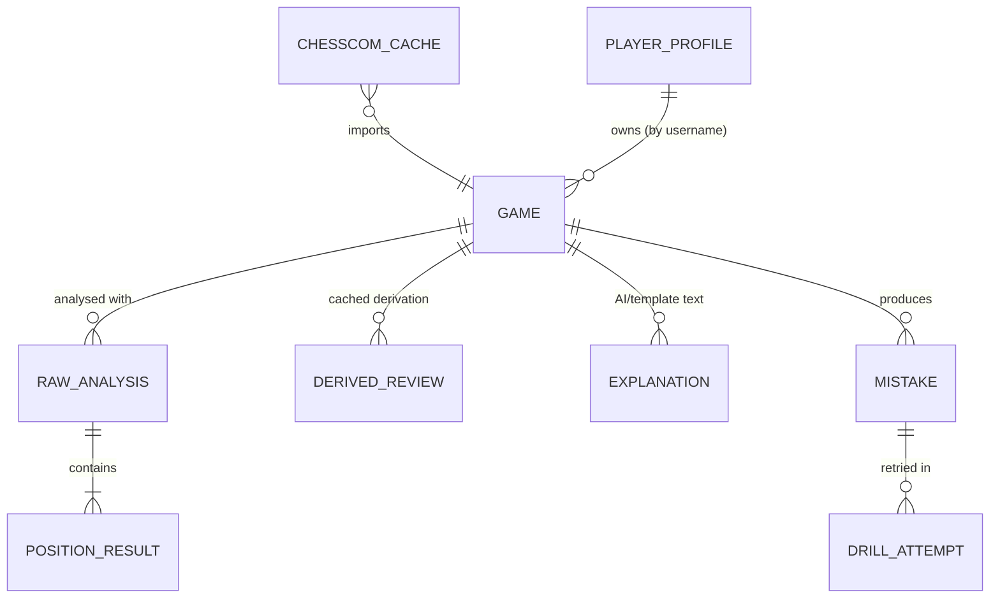

# Data Models

| | |
|---|---|
| Status | Draft v0.2 — Phase 0, revised after owner review |
| Date | 2026-11-03 |
| Storage | IndexedDB through Dexie (schema v1) and localStorage for preferences |

---

## 1. Design principles

1. **Store raw, derive the rest.** Engine output is expensive to produce, so it is stored. Labels, accuracy, phases and motifs are cheap to derive, so they are recomputed with the current `methodologyVersion`, and cached only with that version tag.
2. **Every analysis is tagged with what produced it**: engine build, network, preset. Results from different builds are never mixed.
3. **White-perspective scores everywhere** in storage (see methodology §2).
4. **Moves are stored in UCI** (unambiguous), with SAN cached for display.
5. **Plies are indexed from 0.** Position *k* is the position after *k* half-moves. Move *k* (1-based) leads from position *k−1* to position *k*.
6. Every stored record carries `schemaVersion`. Dexie migrations upgrade old records.

## 2. Entity relationships



## 3. Core chess types (`core/`)

```ts
export type Color = "w" | "b";
export type Uci = string;     // "e2e4", "e7e8q", "e1g1"
export type San = string;     // "e4", "exd8=Q+", "O-O"
export type Fen = string;
export type Epd = string;     // first four FEN fields

export type Score =
  | { kind: "cp"; value: number }                       // White POV
  | { kind: "mate"; moves: number }                     // ≠ 0, White POV sign
  | { kind: "terminal"; result: "1-0" | "0-1" | "1/2-1/2" };

export interface Ply {
  index: number;              // 1..n (move index); position index = this
  uci: Uci;
  san: San;
  color: Color;               // mover
  fenAfter: Fen;
  clockSeconds?: number;      // from [%clk], if present
}
```

## 4. Games

```ts
export type GameSource =
  | { kind: "chesscom"; url: string; uuid?: string; timeClass: string; rules: string;
      endTime: number; reportedAccuracy?: { white: number; black: number } }
  | { kind: "pgn"; fileName?: string; importedAt: number };

export interface GameRecord {
  id: string;                 // chesscom: "cc:" + uuid (or url hash); pgn: "pgn:" + sha256(normalised movetext + start FEN)
  schemaVersion: 1;
  source: GameSource;
  pgn: string;                // original text, kept verbatim for export
  headers: Record<string, string>;
  startFen: Fen;              // standard start or [FEN] header
  plies: Ply[];
  white: { name: string; rating?: number };
  black: { name: string; rating?: number };
  result: "1-0" | "0-1" | "1/2-1/2" | "*";
  termination?: string;
  playedAt?: number;          // epoch ms
  timeControl?: { initial: number; increment: number } | { daily: number };
  userColor?: Color;          // resolved from the configured username
  opening?: { eco: string; name: string; bookPlies: number }; // derived, cached
  tags: string[];             // user tags (future)
  createdAt: number;
  updatedAt: number;
}
```

`id` makes imports idempotent: importing the same game twice updates the existing record instead of duplicating it.

## 5. Engine analysis (raw, expensive)

```ts
export interface EngineIdentity {
  name: "stockfish";
  version: string;            // "19.0.1"
  flavour: "lite-single" | "full-single";
  nnue?: string;              // network file name if reported
}

export interface AnalysisSettings {
  preset: "quick" | "standard" | "deep" | "custom";
  nodes: number;
  maxDepth: number;
  multiPv: 1 | 2 | 3;
  hashMb: number;
  freshHashPerPosition: boolean;
}

export interface EngineLine {
  rank: number;               // multipv index, 1-based
  score: Score;               // White POV
  wdl?: [number, number, number]; // per-mille, White POV, if reported
  depth: number;
  selDepth?: number;
  nodes: number;
  pv: Uci[];                  // full PV as reported
}

export interface PositionResult {
  positionIndex: number;      // 0..n
  status: "done" | "terminal" | "failed";
  terminal?: Score & { kind: "terminal" };
  lines: EngineLine[];        // empty when terminal/failed
  bestMove?: Uci;
  timeMs?: number;
  error?: string;
}

export interface RawAnalysis {
  id: string;                 // `${gameId}|${engineKey}|${settingsHash}`
  schemaVersion: 1;
  gameId: string;
  engine: EngineIdentity;
  settings: AnalysisSettings;
  settingsHash: string;       // stable hash of settings + engine identity
  positions: PositionResult[];   // index = positionIndex; may be partial
  completedCount: number;
  totalCount: number;
  startedAt: number;
  completedAt?: number;
}
```

Size estimate: 81 positions × 2 lines × a PV of about 20 moves ≈ 40–80 KB per game in JSON. 1,000 games ≈ 40–80 MB, which is well within IndexedDB limits. PV length is capped at 24 plies.

## 6. Derived review (cheap, versioned)

```ts
export type Label =
  | "book" | "forced" | "best" | "excellent" | "good"
  | "inaccuracy" | "mistake" | "blunder" | "miss"
  | "great" | "brilliant";

export type Severity = "best" | "excellent" | "good" | "inaccuracy" | "mistake" | "blunder";

export interface MoveAnalysis {
  plyIndex: number;
  color: Color;
  san: San; uci: Uci;
  scoreBefore?: Score;         // White POV; undefined if that position's analysis failed
  scoreAfter?: Score;          // White POV; undefined if that position's analysis failed
  winBefore?: number;          // mover POV, 0..100
  winAfter?: number;           // mover POV
  winLoss?: number;            // ≥ 0
  cpLoss?: number;             // mover POV, ceiled (methodology §6.6)
  bestMove?: { uci: Uci; san: San; winAfter: number };
  secondBest?: { uci: Uci; san: San; winAfter: number };
  bestLineSan: San[];          // PV from the position before
  refutationSan: San[];        // PV from the position after (opponent to move)
  severity?: Severity;         // undefined if ungraded
  label?: Label;               // undefined if ungraded
  labelReasons: string[];      // machine-readable rule ids, e.g. ["band:blunder","mate:allowed"]
  accuracy?: number;           // move accuracy 0..100; undefined if scoreBefore/After missing
  volatilityWeight?: number;   // undefined if any position in its window is missing (methodology §6.2)
  countsTowardAccuracy: boolean; // accuracy && weight defined && !(forced && mode === "default")
  phase: "opening" | "middlegame" | "endgame";
  motifs: MotifTag[];
  clockSeconds?: number;
  graded: boolean;             // has a label (false when either eval is missing)
}

export interface PlayerSummary {
  accuracy?: number;           // game accuracy, full precision; undefined if no counted moves
  accuracyMode: "default" | "lichessCompat";
  accuracyByPhase: Partial<Record<"opening" | "middlegame" | "endgame", number>>;
  acpl?: number;
  labelCounts: Record<Label, number>;
  gradedMoves: number;
  ungradedMoves: number;       // missing evals
  countedMoves: number;        // contributed to game accuracy
  excludedForced: number;      // default mode only
  excludedMissingWeight: number; // shown as "N moves not included in accuracy"
}

export interface GameReview {
  gameId: string;
  rawAnalysisId: string;
  methodologyVersion: string;
  moves: MoveAnalysis[];
  white: PlayerSummary;
  black: PlayerSummary;
  winSeries: (number | null)[]; // White-POV Win% per position, null where analysis failed (graph shows a gap)
  phaseBoundaries: { middlegameStartPly?: number; endgameStartPly?: number };
  keyMoments: number[];        // ply indices
  derivedAt: number;
}

export interface MotifTag {
  id: MotifId;                 // "hanging_piece" | "fork" | "missed_fork" | ...
  side: Color;                 // who benefits / who is affected (documented per motif)
  confidence: "high" | "medium";
  evidence: { squares?: string[]; moveSan?: San; pvPly?: number; note?: string };
}
```

`GameReview` is cached in the `reviews` table keyed by `[rawAnalysisId, methodologyVersion]`. On load: if the methodology version matches, the cached review is used. Otherwise it is re-derived from `RawAnalysis` in a few milliseconds.

## 7. Coach outputs

```ts
export type CoachLevel = "beginner" | "intermediate" | "advanced";

export interface ExplanationRecord {
  id: string;                  // hash(promptVersion, provider, model, level, task, factsHash)
  gameId: string;
  plyIndex?: number;           // undefined for game summary
  task: "explain_move" | "summarize_game" | "describe_patterns" | "training_plan";
  level: CoachLevel;
  source: "llm" | "template";
  provider?: "gemini" | "claude" | "openai";
  model?: string;
  promptVersion: string;
  methodologyVersion: string;
  content: unknown;            // validated MoveExplanation | GameSummary | ...
  usage?: { inputTokens: number; outputTokens: number };
  createdAt: number;
}

export interface UsageLedgerEntry {
  id?: number;
  at: number;
  provider: string; model: string; task: string;
  inputTokens: number; outputTokens: number;
  ok: boolean; errorCode?: string;
}
```

## 8. Learning features

```ts
export interface MistakeRecord {
  id: string;                  // `${gameId}:${plyIndex}`
  gameId: string;
  plyIndex: number;
  color: Color;
  fenBefore: Fen;
  playedUci: Uci;
  bestUci: Uci;
  acceptableUci: Uci[];        // moves within 'good' band of best (from MultiPV), for retry checking
  label: Label;
  winLoss: number;
  motifs: MotifId[];
  phase: "opening" | "middlegame" | "endgame";
  playedAt?: number;
  // spaced repetition
  srs: { dueAt: number; intervalDays: number; streak: number; lapses: number };
  archived: boolean;
}

export interface DrillAttempt {
  id?: number;
  mistakeId: string;
  at: number;
  answerUci: Uci;
  correct: boolean;            // answer ∈ acceptableUci, or engine confirms it within the 'good' band
  verifiedByEngine: boolean;
}

export interface PlayerProfile {
  id: string;                  // `${platform}:${lowercased username}`, e.g. "chesscom:exampleuser"
  username: string;
  platform: "chesscom";
  ratings?: Record<string, number>;
  lastSyncedArchive?: string;  // "2026/11"
}

export interface PatternClaim {
  motif: MotifId;
  level: "emerging" | "established";
  occurrences: number;
  games: number;
  totalGamesConsidered: number;
  ratePerGame: number;
  wilsonLower90: number;
  evidence: { gameId: string; plyIndex: number }[];
  byPhase: Partial<Record<"opening" | "middlegame" | "endgame", number>>;
}

export interface PatternReport {
  generatedAt: number;
  gamesAnalysed: number;
  methodologyVersion: string;
  claims: PatternClaim[];
  insufficient: { motif: MotifId; occurrences: number; gamesNeeded: number }[];
}

export interface TrainingPlan {
  items: { drillId: string; title: string; why: string; frequency: string }[];
  basedOnReportAt: number;
}
```

## 9. Chess.com cache

```ts
export interface HttpCacheEntry {
  url: string;                 // primary key
  etag?: string;
  lastModified?: string;
  fetchedAt: number;
  immutable: boolean;          // true for past months
  body: unknown;               // validated JSON
}
```

## 10. Settings

```ts
// localStorage key "prefs.v1": small and non-sensitive
export interface Preferences {
  theme: "system" | "light" | "dark";
  boardOrientation: "auto" | "white" | "black";
  chesscomUsername?: string;
  analysisPreset: "quick" | "standard" | "deep";
  engineFlavour: "lite-single" | "full-single";
  workerCount?: number;
  coachLevel: CoachLevel | "auto";
  aiProvider?: "gemini" | "claude" | "openai"; // type is provider-independent; only "gemini" is selectable until Phase 4b
  aiModel?: string;
  sendPlayerNames: boolean;    // default false
  showChesscomAccuracy: boolean;
}

// IndexedDB table "secrets": ONLY when the user opts in to "remember key"
export interface StoredSecret {
  id: "gemini" | "claude" | "openai";
  apiKey: string;              // never logged, never exported
  savedAt: number;
}
```

## 11. Dexie schema v1

```ts
db.version(1).stores({
  games:        "id, playedAt, userColor, source.kind, [source.kind+playedAt]",
  rawAnalyses:  "id, gameId, settingsHash, completedAt",
  reviews:      "[rawAnalysisId+methodologyVersion], gameId",
  explanations: "id, gameId, [gameId+plyIndex], task",
  mistakes:     "id, gameId, srs.dueAt, label, *motifs, archived",
  drillAttempts:"++id, mistakeId, at",
  usage:        "++id, at, provider",
  httpCache:    "url, fetchedAt",
  profiles:     "id",
  secrets:      "id",
});
```

Migration rules:
- Never drop user data in a migration. A schema version bump has an `upgrade()` that converts records.
- Backup export (`.json`) includes every table **except** `secrets`. Import validates with Zod and merges by primary key.

## 12. Notation conversions (boundaries)

| From → To | Where | Tool |
|---|---|---|
| PGN SAN → `Ply` (UCI + SAN + FEN) | Import | chess.js |
| UCI PV → SAN PV | Derivation (for display and the AI) | chess.js replay from the position's FEN |
| `Score` (White POV) → display string | UI only | `formatScore`: `+1.24`, `−0.30`, `M3`, `−M2`, `1-0` |
| `Score` → Win% | core/eval | methodology §4 |
