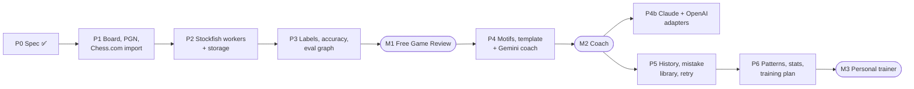

# Development Roadmap

| | |
|---|---|
| Status | v0.4 — **Phase 1 conditionally accepted.** **Phase 2 implemented** on branch `phase-2`, with all stages approved; 15 of 16 acceptance items PASS (see §3, Phase 2 acceptance record). Firefox CI is blocked until the repository exists. Not merged to `main`. |
| Date | 2026-11-03 |

---

## 1. Changes to the proposed phase order

| Change | Reason |
|---|---|
| **Chess.com import moves from Phase 5 to Phase 1.** | It is two CORS-enabled GET endpoints and is low risk. It is also the main way the user brings in games, and Phase 2–3 testing needs real games. |
| **IndexedDB starts in Phase 2, not Phase 6.** | Resumable analysis and "don't re-analyse on reload" need persistence as soon as the engine exists. |
| **The template coach comes before the LLM coach in Phase 4.** | It gives a useful coach panel without a key, and it is the fallback for every AI failure. |
| **Phase 4 implements Gemini only. Claude and OpenAI move to Phase 4b.** | Prompts, schemas and the validator get tuned against one provider first. The interfaces stay provider-independent. |
| **The mistake library and retry mode get their own phase (5), before statistics (6).** | They give learning value from a single game. Statistics need dozens of analysed games before they mean anything. |

## 2. Milestones

Phase 4b is independent of Phases 5–6 and can be done whenever the Gemini coach is judged stable. Effort per phase is in §4.

- **M1 — "Free Game Review" (end of Phase 3).** A complete engine-based review with no AI. This is the first release worth using daily.
- **M2 — "Coach" (end of Phase 4).** Explanations at three levels, from Gemini or the templates.
- **M3 — "Personal trainer" (end of Phase 6).** Patterns, a dashboard and a training plan.

## 3. Phases

### Phase 0 — Technical specification ✅ (this document set)
Exit: the owner approves the docs. Open decisions are listed in §6.

### Phase 1 — Foundation and import

**Build**
- **Environment:**
  - Node **24 LTS** (`.nvmrc`, `engines`, `engine-strict`) and npm;
  - `git init` with a `.gitignore`;
  - Vite 8 + React 19 + TypeScript 6.0 (strict, pinned; see architecture D0) + Tailwind 4;
  - ESLint with the import-boundary rule, Vitest 5, Playwright;
  - the folder structure from [TECHNICAL_ARCHITECTURE §4](TECHNICAL_ARCHITECTURE.md#4-project-structure-proposed);
  - `docs/DEPENDENCIES.md`.
- **`core/chess` and `core/pgn`:** single or multi-game PGN, custom-FEN starts, `%clk` extraction, SAN↔UCI, terminal-state detection (mate, stalemate, insufficient material, threefold repetition from the move history, the 50-move rule), and plain PGN export.
- **Board** (`react-chessboard`):
  - orientation, automatic from the configured username or flipped manually;
  - last-move highlight;
  - navigation by buttons, arrow and Home/End keys, and clicking the move list;
  - the arrow API wired up (it is first used in Phase 3).
- **Home:**
  - paste or upload a PGN;
  - Chess.com username → months → games → import;
  - a "Recent games" shortcut;
  - a serial request queue, an in-memory cache for past months, and browser revalidation for the current month (architecture §7);
  - non-standard `rules` greyed out.
- **Review layout skeleton:** board / move list / coach columns on desktop, stacked on mobile. Engine, labels and AI areas are placeholders.

**Explicitly not in Phase 1:** the engine, labels, accuracy, AI, and IndexedDB persistence.

**Acceptance criteria (all must pass)**
1. **Toolchain:**
   - `node -v` reports 24.x;
   - `npm ci` succeeds with `engine-strict`;
   - `npm run check` (typecheck + lint + unit + integration) is green;
   - `npm run test:e2e` is green in Chromium and Firefox.
2. **Chess rules:** every fixture in `pgn/rules/` passes. That covers:
   - castling on both sides, castling through check, and castling after the rook has moved;
   - en passant, including that it's only allowed on the next move;
   - all four promotions, and underpromotion with check;
   - checkmate, stalemate, insufficient material, threefold repetition detected from the move history, and the 50-move rule;
   - a custom-FEN start with Black to move.
3. **PGN robustness:**
   - every file in `pgn/malformed/` produces an error naming the game and the move or line, and never crashes or freezes the UI;
   - comments, NAGs, variations, a BOM and CRLF line endings are handled;
   - the parse → export → parse round trip is identical on the whole `pgn/chesscom/` corpus;
   - `%clk` values match by-hand checks on 3 games.
4. **Coverage:** `core/chess` and `core/pgn` have ≥ 90% line coverage and ≥ 85% branch coverage.
5. **Board and navigation:**
   - keyboard and click navigation always show the correct FEN for the selected ply. An E2E test checks this against chess.js for every ply of 3 games;
   - orientation follows the configured username.
6. **Chess.com import** (MSW E2E plus a manual check):
   - username validation;
   - 404, 410, 429 (with backoff) and offline each show the specified message;
   - no two requests are ever in flight at once;
   - a revisited past month is served from the cache without a second request. This criterion was revised in Phase 1: the API's CORS policy doesn't allow scripts to send `If-None-Match` (architecture §7);
   - **live check: the owner's 10 most recent Chess.com games import and step through correctly** (`npm run test:live`, see testing §4.7).
7. **Responsive and accessible:**
   - no horizontal scroll at 375 px width;
   - the board is usable at that width;
   - axe reports no critical violations on Home and Review;
   - every control can be reached with the keyboard.
8. **Licensing:** `docs/DEPENDENCIES.md` lists every runtime dependency with its licence, and a CI-style script fails if a dependency's licence is not on the allow-list.

#### Phase 1 acceptance record (2026-11-03)

**Overall: CONDITIONALLY ACCEPTED by the owner.** Phase 1 is *not* fully passed. Two items stay open and are tracked as follow-ups F1 and F2 (§3.1). Status meanings are defined in [TESTING_STRATEGY §7](TESTING_STRATEGY.md#7-acceptance-status).

| # | Criterion | Status | Evidence |
|---|---|---|---|
| 1a | Node 24.x, clean `npm ci` with `engine-strict` | PASS | Node 24.22.1, npm 11.19.1 |
| 1b | `npm run check` green | PASS | typecheck, lint, licence check, **241 unit + integration tests passing**, coverage thresholds met |
| 1c | E2E green in **Chromium** | PASS | **30/30** tests passing against the production build |
| 1d | E2E green in **Firefox** | **BLOCKED — ENVIRONMENT** | See below. Follow-up F1. |
| 2 | Chess rules fixtures | PASS | All `pgn/rules/` tests |
| 3 | PGN robustness | PASS | 9/9 malformed fixtures report located errors; round trip identical on all 37 valid fixture files; clocks hand-checked on 3 games |
| 4 | Coverage of `core/` | PASS | Lines 99.72%, branches 95.95% (targets 90% / 85%) |
| 5 | Board and navigation | PASS (Chromium) | FEN text and rendered pieces checked at every ply of 3 games |
| 6a | Chess.com import: validation, 404/410/429/offline, serial requests, past-month cache | PASS (Chromium + integration) | |
| 6b | **The owner's own 10 most recent games** import and step through correctly | **PENDING** | Not yet run: the owner's username hasn't been provided. The same check passed on the public account `hikaru` (10/10 games, every move replayed, final positions match Chess.com's), which shows the import works against real data. **It does not satisfy this criterion.** Follow-up F2. |
| 7 | Responsive and accessible | PASS (Chromium) | No horizontal scroll at 375 px; axe: no serious or critical violations (light and dark); every control reachable by Tab |
| 8 | Licensing | PASS | All 18 runtime dependencies on the allow-list |

**Firefox E2E — BLOCKED (ENVIRONMENT), not PASS**
- **Machine:** the owner's PC, Windows 11 Home Single Language, build **10.0.26300** (a pre-release build).
- **Browser:** Playwright 1.64.1 Firefox build `firefox-1555`, installed with `npx playwright install firefox`.
- **Failure:** every Firefox test fails at launch with `browserType.launch: spawn UNKNOWN`. Running `firefox.exe` directly fails with *"The application has failed to start because its side-by-side configuration is incorrect"*. The Windows Application event log (source SideBySide) records: *Activation context generation failed for "…\ms-playwright\firefox-1555\firefox\firefox.exe". Dependent Assembly mozglue … version="1.0.0.0" could not be found.*
- **Checked:** `mozglue.dll` is present in the install folder, and Playwright marked the install `INSTALLATION_COMPLETE`.
- **Reinstall attempted:** `npx playwright install --force firefox` completed, but the launch fails identically.
- **Not a test failure:** no Firefox test ever started. Chromium runs the same suite 30/30 on the same machine.
- **Not substituted:** WebKit is **not** an acceptable replacement for Firefox for this criterion.

### 3.1 Phase 1 follow-ups (open)

| ID | Task | Done when | Owner |
|---|---|---|---|
| F1 | **Run the Firefox E2E suite on another machine or in CI.** Use any machine where Playwright's Firefox launches: a different Windows build, Linux, macOS, or a CI runner. Run `npx playwright install firefox`, then `npx playwright test --project=firefox`. | The Firefox project passes in full (30/30, or the full count at that time) and the result is recorded in the acceptance record above, replacing BLOCKED. If it fails, the failures are fixed or recorded. | Owner to provide the machine or CI; then Claude |
| F2 | **Validate with the owner's own Chess.com account.** Run `LIVE_CHESSCOM_USER=<owner's username> npm run test:live`. | All 10 most recent games import, every move replays, and final positions match Chess.com's. Criterion 6b recorded as PASS. | Owner to provide the username |

### Phase 2 — Stockfish integration

**Build**
- Copy `stockfish` 19.0.1 `bin/stockfish-19-lite-single.{js,wasm}` (and `Copying.txt`) into `public/engine` at build time.
- `UciParser` (pure), the `EngineWorker` state machine, `EnginePool`, a priority `AnalysisQueue`, and cancel/resume.
- Presets (node budgets) and White-perspective normalisation. Terminal positions come from `core/chess` and are never sent to the engine.
- Dexie schema v1: `games`, `rawAnalyses`, `httpCache`. Analyses resume after a reload.
- `navigator.storage.persist()` is requested once, after the first successful write. This was moved here from Phase 5 by decision D7, because Phase 2 is when data is first stored.
- `scripts/record-engine-fixtures.mjs`, the benchmark (`npm run bench`, `npm run bench:builds`; decision D9) and `docs/BENCHMARKS.md`.
- A temporary debug view showing the raw eval per ply.

**Tests:** parser unit tests from transcripts; engine integration (`@engine`) for sign, mate, determinism, lifecycle and pool indexing.

**Exit criteria:**
- Benchmarks are recorded and the preset node budgets adjusted.
- Decision U4 (the full build for Deep) is made.
- A full game analyses without UI jank (no main-thread long tasks over 50 ms during analysis).
- A killed worker is recovered from.

Implemented on branch `phase-2` in four commits (Stages 1–4). The approved Stage 0 decisions D1–D16 are recorded in the docs where they apply.

#### Phase 2 acceptance record (2026-11-11)

**Overall: 15 of 16 items PASS. Phase 2 is not fully accepted:** item 14 (Firefox E2E) is PENDING a CI re-run after the fix for the bug that Firefox on Ubuntu found. All four stages are approved and committed on `phase-2`.

**Repository (D13, changed by the owner on 2026-11-11):** the CI repository `github.com/Anurag-Ahirwar/my-chess-coach` is **public**, not private as planned. The owner accepted that the commit history shows the author's email address and that the code has no licence yet (U1). Status meanings: [TESTING_STRATEGY §7](TESTING_STRATEGY.md#7-acceptance-status).

| # | Definition of Done | Status | Evidence |
|---|---|---|---|
| 1 | Stockfish 19.0.1 lite single-threaded loads in Chromium (dev and production build) and in Node | PASS | `engine-load.spec.ts`: 2/2 on the production build and 2/2 on the dev server (`E2E_TARGET=dev`), with no CSP violations and the files served with correct types and sizes. `@engine` handshake in Node. Load measured at 116–119 ms cold (BENCHMARKS §2.1). |
| 2 | UCI parser passes transcript tests (bounds, MultiPV, mate, WDL, garbled input) | PASS | `uciParser.test.ts` (53) and `transcripts.test.ts` (39): 24 golden transcripts from the npm build, with expected values read by hand. |
| 3 | Cancel, timeout, crash and quit leave no pending promises; a killed worker is recovered | PASS | `engineWorker.test.ts` asserts `hasPendingOperation === false` on every path. `@engine` covers real `stop`, timeout, process kill and `quit`, plus the pool respawning a killed engine and retrying its job once. |
| 4 | White perspective; mate never stored as centipawns; signs checked for both sides to move | PASS | Conversion happens in one place (the parser). `@engine` scenarios cover mate ±1 for each side and side to move, and material advantage with White and with Black to move. The stored schema rejects `mate 0`. |
| 5 | Terminal positions resolved by rules and never sent to the engine | PASS | `@engine`: checkmate (both colours) and stalemate games record every `position` command; the final position's command never appears. Unit tests for `terminalScore` (D6). |
| 6 | Node budgets and depth caps respected; deterministic for a fixed build and settings | PASS | `@engine`: nodes ≤ budget + 2 048 and depth ≤ cap. Determinism: two separate pools gave identical whole-game results, and `record:engine --verify` reproduced 24/24 transcripts. Node and Chromium gave the same result for the same search. |
| 7 | Every stored PV and best move is legal | PASS | `resultFromOutcome` replays the best move and every PV before storing (unit tests include illegal-move cases). `@engine` and transcript tests check legality on real output. |
| 8 | Raw analysis persists, resumes after a reload, is reused when complete; settings never collide | PASS | Repository tests (`fake-indexeddb` plus a reopen); controller resume after a "reload" (only 8 of 13 positions re-searched); E2E with a real browser reload: stop, reload, resume, then reuse. Quick and Standard of one game are stored as separate records. |
| 9 | Storage failure handled without losing data or breaking import and review | PASS | IndexedDB disabled in E2E: banner shown, import, review **and analysis** work in memory. Quota and invalid-record paths are unit-tested; invalid records are never overwritten. |
| 10 | A full game analyses with no main-thread long tasks over 50 ms | PASS | `analysis.spec.ts` (with a positive control) and every benchmark run, 1–4 engines and all presets: 0 long tasks (BENCHMARKS §2.4). |
| 11 | Benchmarks recorded; node budgets and pool size adjusted from them | PASS | `docs/BENCHMARKS.md` plus raw JSON. Budgets and pool formula were **evaluated against explicit targets and kept** (§4, with reasons). The search time cap was **recalibrated** to `10 s + nodes/50 000`. |
| 12 | Decision U4 made with evidence | PASS | **Decided by the owner on 2026-11-11: lite only, no full build.** Evidence in BENCHMARKS §3: the full build is 99 MB, uses about 2.8× the memory, has 1.8× fewer nodes/s, and gives the same best move in 73% of positions. |
| 13 | All Phase 1 tests and all new tests pass; coverage thresholds met | PASS | `npm run check`: **508** unit and integration tests; coverage of `core/` and `infra/engine/` 99.23% lines, 94.77% branches. `test:engine` **25/25**. Chromium E2E **43/43**. The only changed Phase 1 test is the approved A10 heading change. |
| 14 | Firefox E2E passes in CI, or is recorded as BLOCKED with evidence | **PENDING (CI re-run after a fix)** | CI run [42871893922](https://github.com/Anurag-Ahirwar/my-chess-coach/actions/runs/42871893922) on `7160783`: check + engine tests ✅, Chromium/Ubuntu ✅, **Firefox/Windows ✅**, **Firefox/Ubuntu ❌**, with 41 passed, 1 skipped (the long-task test is Chromium-only by design) and 1 failed. The failure was a **real bug**: imports navigated before the IndexedDB save finished, so a page load right after an import could lose the game. It is fixed in `f05827f` (navigation now waits for the save; regression unit tests added). Re-run [42874613978](https://github.com/Anurag-Ahirwar/my-chess-coach/actions/runs/42874613978) on `f05827f`: that test now **passes** on Firefox/Ubuntu, and the other three jobs pass again. One different test failed: "every review control can be reached with the Tab key". It pressed Tab before the review page appeared (focus only ever reached the Home page's game list), because the test never waited for the page and navigation is no longer instant. The test now waits for the review page; its checks are unchanged. Awaiting a CI re-run. |
| 15 | Production build succeeds; licence check passes with stockfish (GPL-3.0) and dexie recorded | PASS | `npm run build` succeeds, with a bundle-size warning only. `npm run licenses`: 20/20 allowed, including `stockfish@19.0.1 GPL-3.0` and `dexie@4.4.7 Apache-2.0`. Both are in DEPENDENCIES.md. |
| 16 | All deviations from the specs documented | PASS | D1–D16 recorded in DATA_MODELS (§4, §5, §9, §10, §11), methodology (§3, §5.1), architecture (D10, §6.1, §7, §11), TESTING_STRATEGY, DEPENDENCIES, BENCHMARKS and this roadmap. |

**Phase 2 follow-ups:**
- **F1** (Firefox E2E) now has a concrete path: push to the private repository and let `ci.yml` run.
- **F3:** add an E2E test for an analysis *in progress* across a reload with the real engine, i.e. a reload *during* a run rather than after Stop. Optional: the controller-level test covers the interrupted-save case.
### Phase 3 — Game review system → **M1**

**Build**
- `core/eval` (Win%), `core/classify` (bands, mate rules, Forced, Book, Miss), `core/accuracy` (move, game and phase accuracy, ACPL, in `default` and `lichessCompat` modes), `core/phases`.
- An opening index generated from the Lichess CC0 dataset (`scripts/build-openings.ts`), plus opening names.
- UI:
  - eval bar and eval graph (clickable);
  - label badges on the board square (F2.4), colours with icons, and label counts;
  - accuracy, with the "N moves not included" note;
  - best line, refutation line and best-move arrow.
- The "About this analysis" panel (F8.3): engine identity, preset, methodology version, and the compatibility statement (methodology §0).
- The "About / Licences" screen (architecture §12): every dependency and its licence, with a link to the Stockfish GPL text (`/engine/Copying.txt`, shipped since Phase 2). Placed here by decision D8.
- Optional "Reported by Chess.com" accuracy (F4.7), if U6 = yes.
- The `reviews` cache, keyed by methodology version.
- **Last:** Great and Brilliant behind experimental flags, with the curated fixture positions.

**Tests:**
- methodology tables and the mirror property;
- ported Lichess unit vectors, algorithm edge cases, and the Lichess real-game cross-check (±1 after rounding);
- ACPL;
- regression snapshots;
- Great/Brilliant positive and negative fixtures.

**Exit criteria:**
- All Lichess-compatibility tests pass.
- The owner reviews 10 of their own games and finds the labels sensible.
- Label thresholds (not the accuracy constants) are tuned at most once if needed (decision U2, with a methodology version bump).

### Phase 4 — AI coach (Gemini) → **M2**

**Build**
- `core/motifs` (P1 set: hanging piece, missed capture, allowed/missed mate, fork/missed fork, time trouble, opening deviation).
- The key-moment selector, the `CoachFacts` builder with its **move catalogue**, the `CoachText` token renderer (move chips, square highlights), and **template explanations** (no key needed).
- The `LLMProvider` interface, contract tests and error taxonomy, plus the **Gemini adapter only**.
- The validator (catalogue ids, token parsing, untokenised-notation detection, no evaluation numbers), retry-then-fallback, caching, the usage ledger, and settings for the Gemini key, model and level.
- Game summary and per-move explanations at three levels. A "What is sent" preview.

**Tests:**
- motif fixtures;
- the catalogue builder;
- the validator's reject and accept suites, including the documented-limitation tests;
- the Gemini adapter (MSW);
- the privacy snapshot;
- the golden-set live evaluation (manual).

**Exit criteria:**
- First-try validator pass rate ≥ 95% on the golden set with the chosen Gemini model.
- Every AI move reference shown in the UI comes from the catalogue (enforced by the validator, and covered by tests).
- The by-hand **incorrect-claim rate** has been measured and recorded as the baseline for prompt work.
- The app is fully functional without a key.

### Phase 4b — Additional providers (deferred)
- Claude and OpenAI adapters on the same `LLMProvider` contract tests, a provider picker in settings, and golden-set runs per provider.
- **Start condition:** the Phase 4 exit criteria have held over at least 20 real reviewed games, with no prompt or schema changes needed in the last 10.

### Phase 5 — History, mistake library, retry

**Build**
- A game library (list, filter, delete) that reopens reviews instantly.
- Mistakes captured automatically. "Retry this mistake" with engine verification of alternative good answers. Spaced repetition.
- A variation explorer with live evaluation from the interactive worker (F2.5).
- Full JSON backup export/import (secrets excluded). PGN export with `[%eval]` and labels (F1.8).
- (The `navigator.storage.persist()` request moved to Phase 2, decision D7.)

**Exit criteria:**
- After reviewing 5 games, the owner can drill their own mistakes.
- A backup restores into a fresh browser profile.

### Phase 6 — Personalisation → **M3**

**Build**
- Background batch analysis ("analyse my last 50 games", Quick preset by default, pausable).
- `core/stats` aggregation, evidence-gated `PatternClaim`s, and the "analyse N more games" messaging.
- A dashboard (Recharts):
  - accuracy over time and by time class;
  - an openings table;
  - phase accuracy;
  - blunder rate;
  - time-trouble mistakes.
- Pattern narrative and training plan (Gemini, validated against the candidate drills). Lichess themed-puzzle links.
- P2 motifs (back rank, pin/skewer, promotion, king safety), only if Phase 4 data shows they are needed.

**Exit criteria:** with 25 or more analysed games, at least one Established claim, if one exists, is shown with clickable evidence. No claims are shown below the thresholds.

## 4. Complexity assessment

Sizes assume one experienced TypeScript developer working full days. With AI-assisted development, the coding parts go faster. The slow parts are **fixture curation, validation, and tuning on real games**, and those don't compress much.

| Phase | Size | Estimate | What makes it hard |
|---|---|---|---|
| 1 Foundation + import | M | 3–5 days | PGN edge cases; responsive three-column layout; the acceptance suite |
| 2 Engine | M–L | 4–6 days | Worker lifecycle, cancellation races, determinism, benchmarking |
| 3 Review | L | 5–8 days | Perspective correctness; exact Lichess compatibility; Great/Brilliant rules and their fixtures |
| 4 AI coach (Gemini) | L | 5–8 days | Motif detectors (SEE, forks); the catalogue and validator; prompt iteration |
| 4b Claude + OpenAI | S | 1–2 days | Vendor structured-output differences |
| 5 Learning | M | 4–6 days | Retry verification with the engine; the variation explorer; backup/migrations |
| 6 Personalisation | XL | 8–12 days | Statistics gating, batch-analysis UX, dashboard, training-plan grounding |
| **Total** | | **≈ 30–47 days** | |

M1 (a usable free reviewer) is about 12–19 days in.

## 5. Risk register

| # | Risk | Likelihood | Impact | Mitigation |
|---|---|---|---|---|
| R1 | **Perspective or sign bugs** silently mislabel moves | Medium | Critical | Single normalisation point; mirror property tests; Lichess compatibility tests; engine sign tests |
| R2 | **The LLM makes plausible but false claims** about valid catalogue moves (e.g. "Ng5 attacks your queen" when it doesn't). Syntactic validation can't detect this (AI_COACH_DESIGN §7.3). | High | High | Motif evidence in the facts; prompt restricts reasoning to the supplied facts; low temperature; clickable move chips; AI text labelled as an interpretation; template fallback; a by-hand incorrect-claim rate tracked per prompt version |
| R3 | **Brilliant/Great feel wrong** compared with what users expect | High | Medium | Experimental flags; conservative rules; omit when unsure; tune with the owner's feedback |
| R4 | Engine too slow or memory-heavy on weaker machines, especially with the full net | Medium | Medium | Lite build by default; configurable worker count; node budgets from benchmarks |
| R5 | **Motif detection scope creep** (pins, skewers, positional themes) | High | Medium | A fixed P1 motif list; add more only when data shows a need |
| R6 | Users compare our accuracy with Chess.com's and lose trust | High | Low–Medium | The compatibility statement in the About panel; optional side-by-side "Reported by Chess.com"; formulas are never tuned towards Chess.com |
| R7 | Chess.com API changes, rate limits or blocking | Low | Medium | Serial queue + caching; PGN fallback always available |
| R8 | Browser data eviction loses history | Low | High | `storage.persist()`; JSON backup; reminder after N games without a backup |
| R9 | LLM vendor API churn (model IDs, structured-output formats, CORS policy) | Medium | Low | Thin adapter; model IDs in config; the template fallback means nothing breaks hard |
| R10 | **GPL-3.0 obligations** if the app is shared | Low (personal use) | High (if distributed) | Decide the project licence before any distribution (U1) |
| R11 | Phase 6 never feels useful because too few games are analysed | Medium | Medium | Batch "analyse my last 50" at the Quick preset; clear progress toward the thresholds |
| R12 | Toolchain drift: the TypeScript 7 / typescript-eslint gap, and Node 24 entering its final maintenance year in 2027 | Medium | Low | Exact lockfile; pinned TS 6.0; Node 26 re-evaluation after M2 (architecture D0) |
| R13 | Lichess changes its accuracy code later | Low | Low | Our compatibility claim is tied to the source revision read on 2026-11-03. The constants are frozen in `LICHESS_ACCURACY_V1`. |
| R14 | **Playwright's Firefox won't start on the owner's machine.** Windows build 26300 reports a side-by-side error: the `mozglue` assembly can't be bound, even after a clean reinstall. Chromium works. | Certain (on this machine) | Medium | Phase 1 E2E is verified in Chromium only, and Firefox is recorded as BLOCKED — ENVIRONMENT. Decided (U13): run the Firefox project on another machine or in CI (follow-up F1). WebKit is not a substitute. Retry locally after Windows or Playwright updates. Phase 2: `.github/workflows/ci.yml` runs Firefox on Ubuntu and Windows in GitHub Actions. On the first run Firefox/Windows passed, and Firefox/Ubuntu found an import-then-reload bug, now fixed and awaiting a re-run. |
| R15 | **Memory on low-RAM devices**: each engine uses about 145–173 MB (BENCHMARKS §2.5), so the default 4 engines take about 0.6 GB | Medium | Medium | The engine count is user-configurable (1–4). Possible later improvement: cap "auto" by `navigator.deviceMemory` (Chromium only). |

## 6. Unresolved decisions

| ID | Decision | Options | Recommendation | Needed by |
|---|---|---|---|---|
| U1 | Project licence | Private / GPL-3.0 | GPL-3.0 if it is ever shared; stays private otherwise | Before any distribution |
| U2 | Blunder threshold | 20 Win% (our default) / 15 (Lichess) | Start at 20 and review after 10 real games | End of Phase 3 |
| U3 | Rating-aware Win% curve | No / later | Later (needs calibration data; it would be a separate, clearly non-Lichess mode) | Post-M3 |
| U4 | ~~Engine build for the Deep preset~~ **Decided 2026-11-11: lite only.** The full build is not added (BENCHMARKS §3). Revisit only if Phase 3 classification shows instability that a stronger network would fix. | — | — | Resolved |
| U5 | API key storage | Memory only / remember in IndexedDB / local proxy | Memory by default + opt-in remember | Phase 4 |
| U6 | Show Chess.com-reported accuracy next to ours | Yes / No | Yes, opt-in, clearly labelled | Phase 3 |
| U7 | Default Gemini model | Current Flash-tier / Pro-tier | Flash-tier (free tier), after checking current limits and IDs | Phase 4 |
| U8 | Send player names to the LLM | Off / On | Off by default | Phase 4 |
| U9 | Package manager | npm / pnpm | npm (installed with Node) | Phase 1 |
| U10 | Desktop wrapper | None / Tauri | None for now; revisit if key security matters | Post-M2 |
| U11 | Chess.com username(s) to configure as "me" | — | Owner to provide. **Still open; blocks follow-up F2.** | Phase 1 follow-up |
| U12 | Move to Node 26 LTS | Now / after M2 | After M2, or Q2 2027 | Post-M2 |
| U13 | ~~Second E2E browser, given R14~~ **Decided 2026-11-03:** run Firefox on another machine or in CI (F1). WebKit is not a replacement. | — | — | Resolved |

## 7. Immediate next step

Phase 1 is conditionally accepted, with follow-ups F1 (Firefox E2E elsewhere) and F2 (the owner's own games) open. **Phase 2 does not start until the owner explicitly approves it.**
