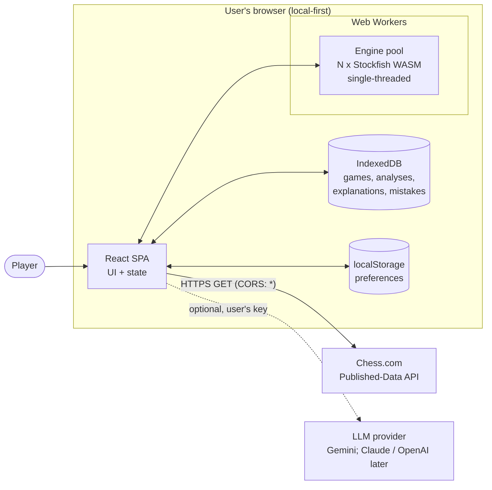
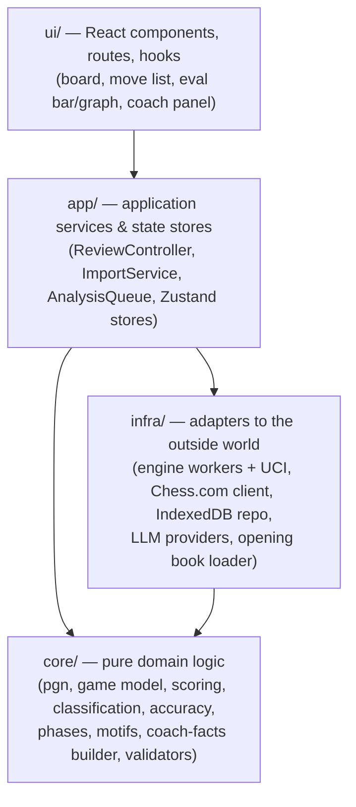
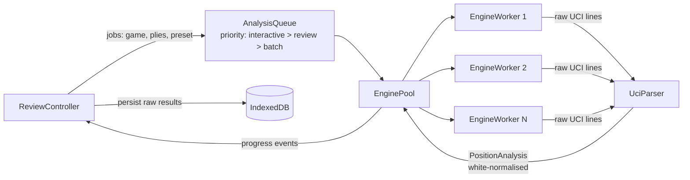
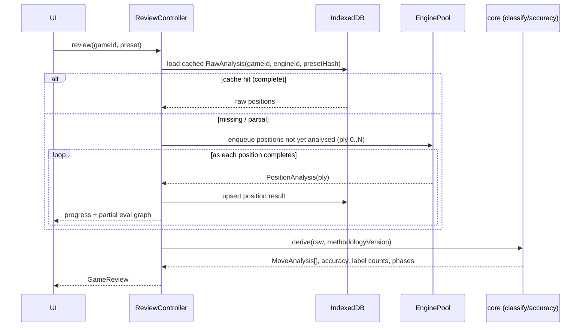
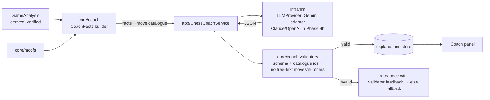

# Technical Architecture

| | |
|---|---|
| Status | Draft v0.2 — Phase 0, revised after owner review |
| Date | 2026-11-03 |
| Scope | Local-first single-user web app. A hosted version is discussed only to keep that path open. |

---

## 1. Existing project assessment

`D:\chess.com` was empty when this was written: no source, configuration, or git repository. There is nothing to reuse or migrate. Two environment findings matter:

| Finding | Impact | Action |
|---|---|---|
| Node.js **20.9.0** is installed | Node 20 reached end of life on 2026-04-30. Vite 8 needs ≥ 20.19, and Vitest 5 needs ≥ 22.12. | Install **Node 24 LTS** before Phase 1 (D0). |
| Not a git repository | No history or safety net for changes. | `git init` at the start of Phase 1. |

### D0. Runtime and toolchain versions (verified 2026-11-03)

**Node.js release status** (from the official `nodejs/Release` schedule):

| Line | Status on 2026-11-03 | End of life | Engine ranges it satisfies |
|---|---|---|---|
| 20 "Iron" | **End of life** (2026-04-30) | — | Excluded by Vitest 5 |
| 22 "Jod" | Maintenance LTS | 2027-04-30 | All, but only about 6 months of support left |
| **24 "Krypton"** | **Maintenance LTS** (since 2026-10-20); latest 24.22.x | **2028-04-30** | **All** |
| 26 "Lithium" | Active LTS (since 2026-10-28, six days ago); latest 26.13.x | 2029-04-30 | All |

- **Recommend: Node 24 LTS.**
  - It has been an LTS line for a year, so it has the most mature ecosystem support.
  - Every tool below lists it explicitly.
  - Its security support (to April 2028) comfortably covers the whole roadmap.
- **Alternative: Node 26 LTS.** It has a longer support window and every tool also supports it. But it only became LTS this week, so there has been little time for ecosystem issues to surface.
  - **Planned:** re-evaluate moving to Node 26 after M2, or in Q2 2027, whichever is first. The move is cheap because nothing in the app depends on Node-specific APIs. Node is only the toolchain, and the app runs in the browser.
- Pinned with `.nvmrc` (`24`) and `package.json` `"engines": { "node": ">=24.0.0 <25" }`, with `engine-strict=true` in `.npmrc` so a wrong Node version fails at install.

**Package compatibility** (from each package's published `engines` and `peerDependencies` on npm, plus Playwright's system requirements):

| Package | Latest | Node requirement | Node 24 | Notes |
|---|---|---|---|---|
| vite | 8.3.x | `^20.19.0 \|\| >=22.12.0` | ✅ | |
| @vitejs/plugin-react | 6.2.x | `^20.19.0 \|\| >=22.12.0` | ✅ | peer `vite ^8` |
| vitest | 5.1.x | `^22.12.0 \|\| ^24.0.0 \|\| >=26.0.0` | ✅ | peer `vite ^6–^8` |
| @playwright/test | 1.64.x | `>=20`. The docs list 22.x, 24.x and 26.x as supported, and Windows 11. | ✅ | |
| react / react-dom | 19.3.x | none | ✅ | |
| react-chessboard | 5.12.x | `>=20.11.0` | ✅ | peer `react ^19` |
| chess.js | 1.4.x | none | ✅ | |
| tailwindcss / @tailwindcss/vite | 4.3.x | none | ✅ | peer `vite ≤ ^8` |
| dexie | 4.4.x | none | ✅ | |
| stockfish | 19.0.1 | none declared | ✅ | Runs in the browser. Node is used only for the `@engine` tests (the single-threaded build needs no flags on modern Node). |
| eslint | 10.x | `^20.19 \|\| ^22.13 \|\| >=24` | ✅ | |
| typescript-eslint | 8.72.x | `>=21.1` | ✅ | **peer `typescript >=4.8.4 <6.1.0`** |
| **typescript** | 7.0.x is "latest" | — | ✅ | **Pin TypeScript `~6.0.3`** (see below) |

**TypeScript pin.**
- npm's `latest` TypeScript is now 7.0, the native (Go) compiler.
- typescript-eslint, which our import-boundary rule depends on, currently supports only TypeScript **< 6.1**.
- Vite and Vitest strip types without `tsc`, so they don't care about the TypeScript version.
- We therefore pin **TypeScript 6.0.x** for `tsc --noEmit` and ESLint, and move to TS 7 when typescript-eslint supports it.
- The reason for the pin is recorded in `docs/DEPENDENCIES.md`, which is created in Phase 1.

All exact versions are locked in `package-lock.json`. Upgrades are deliberate, one dependency at a time, with the full test suite run after each.

## 2. System context



Nothing else leaves the machine. There is no backend in v1 (see §9).

## 3. Layered design

Dependency rule: arrows point **down only**. The `core` layer is pure TypeScript with no React, no DOM and no I/O, so it can be fully unit-tested in Node.



## 4. Project structure (proposed)

```
chess.com/
├─ docs/                          # this specification
├─ public/
│  └─ engine/                     # stockfish-19-lite-single.{js,wasm} + Copying.txt, copied from npm at build
├─ src/
│  ├─ core/                       # PURE: no React, no fetch, no IndexedDB
│  │  ├─ chess/                   # chess.js wrapper, SAN<->UCI, FEN/EPD helpers, material count
│  │  ├─ pgn/                     # parse/split multi-game PGN, clock extraction, export
│  │  ├─ eval/                    # Score type, perspective normalisation, win% curve
│  │  ├─ classify/                # rule engine for move labels (config + rules)
│  │  ├─ accuracy/                # move & game accuracy, phase accuracy, ACPL
│  │  ├─ phases/                  # opening/middlegame/endgame divider
│  │  ├─ motifs/                  # deterministic tactic tagging (SEE, forks, hanging…)
│  │  ├─ coach/                   # CoachFacts builder, output validators, prompt templates
│  │  └─ stats/                   # cross-game aggregation with sample-size gates
│  ├─ infra/
│  │  ├─ engine/                  # uci-parser.ts, engine-worker.ts, engine-pool.ts
│  │  ├─ chesscom/                # API client: serial request queue, past-month cache, Zod validation
│  │  ├─ storage/                 # Dexie schema, repositories, migrations
│  │  ├─ llm/                     # LLMProvider + gemini/claude/openai adapters
│  │  └─ openings/                # loads bundled ECO dataset → EPD index
│  ├─ app/                        # services, stores (Zustand), analysis queue
│  ├─ ui/                         # components, pages (Home, Review, Mistakes, Stats, Settings)
│  └─ main.tsx
├─ data/openings/                 # Lichess chess-openings TSVs (CC0), preprocessed at build
├─ tests/
│  ├─ fixtures/                   # PGNs, recorded UCI transcripts, Lichess-eval games
│  ├─ unit/  integration/  e2e/
├─ scripts/                       # build-openings.ts, record-engine-fixtures.ts, benchmark.ts
└─ package.json / vite.config.ts / tsconfig.json
```

## 5. Key technical decisions

Each decision lists the recommendation, the reason, the alternatives, the trade-offs and the risks.

### D1. Application form: browser SPA served locally
- **Recommend:** A Vite-built static SPA, run with `npm run dev` or `vite preview` (or any static server). It can be installed as a PWA for offline use.
- **Why:** It needs no installer, uses one codebase, and runs WASM in workers natively. The Chess.com API sends `Access-Control-Allow-Origin: *` (checked 2026-11-03), so no proxy is needed.
- **Alternatives:** Tauri (a small native wrapper around the same SPA) or Electron (heavy).
- **Trade-off:** A browser app cannot keep secrets fully safe (see D11). Tauri could store keys in the OS keychain.
- **Risk:** Low. Wrapping the SPA in Tauri later is straightforward because `core/` and `ui/` don't change.

### D2. UI stack: React + TypeScript + Vite + Tailwind CSS
- **Recommend:** Keep the proposed stack. React 19, TypeScript 6.0 in `strict` mode (pinned, see D0), Vite 8, Tailwind 4.
- **Why:** It is mainstream with a large ecosystem, and react-chessboard targets React.
- **Alternatives:** Svelte or Solid (smaller and faster, but fewer chess components); plain CSS modules instead of Tailwind.
- **Trade-off:** Tailwind class lists get long. We'll put a few design-token CSS variables (label colours, board theme) beside it.
- **Risk:** Low.

### D3. State: Zustand stores + React Router
- **Recommend:** Zustand for review/session state (current ply, analysis progress, settings) and React Router for 5–6 routes.
- **Why:** Minimal boilerplate. Stores can be used outside React, which the analysis controller needs.
- **Alternatives:** Redux Toolkit (heavier), React context only (re-render problems on every engine `info` update), TanStack Query (useful for Chess.com fetches; can be added if needed).
- **Risk:** Low.

### D4. Chess rules: chess.js 1.x
- **Recommend:** chess.js for all rules: legality, SAN/UCI, FEN, PGN parsing, check/mate/draw detection.
- **Why:** Mature, BSD-2 licensed, and supports custom-FEN starts.
- **Alternatives:** chessops (by Lichess; faster, includes Chess960, but GPL-3 and a more functional API).
- **Trade-off:** chess.js doesn't support Chess960. That is acceptable (variants are a non-goal). It is also slow for heavy computation. Our motif detection works on at most a few hundred positions per game, which is fine.
- **Risk:** PGN quirks such as comments, `%clk` annotations and NAGs. Mitigated with a fixture corpus of real Chess.com PGNs (see testing).

### D5. Board: react-chessboard 5.x
- **Recommend:** react-chessboard for rendering, arrows and square highlights. Engine arrows are drawn through its arrow API.
- **Alternatives:** chessground (Lichess's board; excellent but GPL-3 and not React-native), or a custom SVG board.
- **Risk:** Low. Rendering is isolated behind a `<ReviewBoard>` component, so it can be swapped.

### D6. Engine build: Stockfish.js "lite single-threaded" by default
- **Recommend:** npm `stockfish` **19.0.1** (GPL-3.0, Stockfish 19), pinned exactly. Its README recommends the **lite, single-threaded** flavour for most projects, and we use it as the default for every preset:
  - Files: `bin/stockfish-19-lite-single.js` (28 KB) and `bin/stockfish-19-lite-single.wasm` (1,845,971 bytes ≈ 1.8 MB).
  - **Optional, decided in Phase 2 (U4):** the **full single-threaded** build, `bin/stockfish-19-single.js` + `.wasm` (99,169,054 bytes ≈ 99 MB, which includes the large NNUE network). It would be a one-time download for Deep mode, cached in Cache Storage.
  - File list checked against the published package on 2026-11-03.
- **Why:** Lite is far stronger than any club player and loads instantly. The full network changes evaluations a little and costs a ≈99 MB download plus around 100 MB of memory per worker.
- **Alternatives:** Multi-threaded builds (need COOP/COEP, see D7); the ASM-JS build (slow, last resort only).
- **Trade-off:** Lite and full evaluations differ, so an analysis made with one build must not be compared directly with the other. That is why the engine identity is part of the analysis cache key (see [DATA_MODELS](DATA_MODELS.md)).
- **Risk:** Medium. Each worker loads its own copy of the network, so with the full build the pool must shrink to 1–2 workers. To be measured in Phase 2.
- **Not used:**
  - the multi-threaded builds (`stockfish-19.js`, `stockfish-19-lite.js`), which need COOP/COEP (D7);
  - `stockfish-19-asm.js`, which is slow and kept only as a last resort.

### D7. Worker topology: a pool of single-threaded workers
- **Recommend:** An `EnginePool` of `N = clamp(navigator.hardwareConcurrency − 1, 1, 4)` workers (lite build) or `N ≤ 2` (full build). Each job analyses one position, and jobs are spread across workers. A separate **interactive worker** runs live analysis while the user explores variations.
- **Why:** A whole-game review is *embarrassingly parallel*: every position is independent. Spreading positions across single-threaded workers gives multi-core speed **without** `SharedArrayBuffer`, so no COOP/COEP headers are needed. Those headers would block cross-origin resources such as Chess.com avatar images, and would complicate any static hosting. Single-threaded searches with a fixed node budget are also **deterministic**, which makes results reproducible and testable.
- **Alternatives:**
  1. One worker running the multi-threaded engine. It needs COOP/COEP, multi-threaded search is not deterministic, and it scales no better for many short searches.
  2. One single-threaded worker. Simplest, but N times slower.
- **Trade-off:** N copies of the engine's memory (lite: small; full: large). Positions don't share a hash table, so we lose a little speed from transposition reuse.
- **Risk:** Low–medium. Too many workers on laptops can cause thermal throttling. Pool size is user-configurable.

### D8. Search budget: node-limited with a depth cap
- **Recommend:** Presets (initial values, **to be benchmarked in Phase 2**):

| Preset | `go` command | MultiPV | Labels available |
|---|---|---|---|
| Quick | `go nodes 150000 depth 18` | 1 | All except Great/Brilliant |
| Standard | `go nodes 600000 depth 22` | 2 | All |
| Deep | `go nodes 2500000 depth 30` | 2 | All |

- **Why:** Nodes are the actual unit of work. Depth costs vary by orders of magnitude between positions, and `movetime` depends on hardware, which would break reproducibility. A depth cap stops wasted effort in trivial positions. MultiPV 2 is needed to decide "only move" (Great) and makes ties visible.
- **Alternatives:** Fixed depth (the brief's suggestion); fixed `movetime`.
- **Trade-off:** MultiPV 2 makes each search more expensive (to be measured).
- **Risk:** The node values above are guesses until benchmarked. The UI must not promise durations.

### D9. UCI command strategy: full move history, fresh hash per position
- **Recommend:** For position *k*, send `ucinewgame`, then `isready`, then `position fen <gameStartFen> moves <m1 … mk>`, then `go …`.
- **Why:** Sending the **move history** rather than just the FEN of position *k* lets Stockfish see repetitions, so it correctly evaluates threefold-repetition draws. A FEN alone loses that history. `ucinewgame` clears the hash so each position's result doesn't depend on what that worker searched before (reproducibility).
- **Alternatives:** A FEN per position (loses repetition history); keeping the hash between positions (faster, but non-deterministic).
- **Trade-off:** Clearing the hash costs a little speed. Long move lists are trivial for UCI.
- **Risk:** Low.

### D10. Storage: IndexedDB via Dexie; localStorage for preferences only
- **Recommend:** Dexie 4 with versioned schema migrations. localStorage only for small UI preferences (theme, last username, board orientation).
- **Why:** Analyses run to hundreds of KB per game with PVs included, and IndexedDB handles that. Dexie gives typed tables, indexes and migrations.
- **Alternatives:** Raw IndexedDB (verbose), `idb` (thin wrapper, no migrations), SQLite-WASM with OPFS (powerful, but heavier and has its own header requirements).
- **Risk:** Users clearing browser data lose everything. Mitigation: JSON export/import (F6.4), and request `navigator.storage.persist()`.

### D11. LLM access: browser-direct, provider-agnostic, lazily loaded
- **Recommend:** Call providers directly from the browser using the user's own key. The provider adapter code is loaded with dynamic `import()` only when used. Each adapter implements one small `LLMProvider` interface (see [AI_COACH_DESIGN](AI_COACH_DESIGN.md)).
- **Scope:** **Phase 4 implements Gemini only.** A Gemini browser API key works directly. The interface, settings and stored records stay provider-independent.
- **Deferred to Phase 4b**, after the Gemini coach is stable:
  - Claude: direct browser calls need the `anthropic-dangerous-direct-browser-access: true` header (the SDK option `dangerouslyAllowBrowser`).
  - OpenAI: the SDK needs `dangerouslyAllowBrowser: true`.
- **Why:** No backend is needed for a single local user. The "dangerous" flags exist because of the risk of exposing a key on a *public* site, which doesn't apply to a local app with the user's own key.
- **Key handling:** In memory by default. Optional "remember on this device" stores it in IndexedDB with a warning. Never logged, never in URLs, and redacted from error reports. A strict Content-Security-Policy restricts `connect-src` to the Chess.com API and the selected provider's endpoint, and there are no third-party scripts.
- **Alternatives:**
  1. A small local Node proxy that reads keys from `.env`. Better key hygiene, but one more process to run.
  2. Tauri with the OS keychain.
- **Risk:** Medium if the app is ever *hosted* publicly. In that case API calls **must** move behind a backend (see §9).

### D12. Charts: custom SVG for the eval graph; a chart library deferred
- **Recommend:** The eval bar and eval graph are custom React/SVG components (about 150 lines, with full control over clickable points and mate rendering). Add Recharts in Phase 6 for the statistics dashboard.
- **Risk:** Low.

### D13. Opening book: the Lichess `chess-openings` dataset (CC0)
- **Recommend:** At build time, convert the dataset's ~3.5k named lines into an EPD → `{eco, name}` map (every position along each line). Used for the **Book** label and for opening names.
- **Alternatives:** The Lichess Opening Explorer API (network-dependent, rate-limited, may need a token); a Polyglot `.bin` book (licensing varies).
- **Trade-off:** Named lines are not complete theory. Deep book moves outside named lines will get normal engine labels, which is harmless.
- **Risk:** Low.

### D14. Schemas and validation: Zod
- **Recommend:** Zod schemas for every external boundary: Chess.com responses, stored records (on read and migration), and LLM outputs (also converted to JSON Schema for provider structured-output modes).
- **Risk:** Low.

## 6. Engine subsystem

### 6.1 Components



- **`EngineWorker`** wraps one `Worker` running `stockfish-*.js` and owns a strict state machine:

```mermaid
stateDiagram-v2
    [*] --> Booting: new Worker()
    Booting --> Initialising: send "uci"
    Initialising --> Ready: "uciok" → setoption… → "isready" → "readyok"
    Ready --> Searching: ucinewgame, isready, position…, go…
    Searching --> Ready: "bestmove …"
    Searching --> Stopping: cancel → "stop"
    Stopping --> Ready: "bestmove …"
    Booting --> Failed: onerror / load timeout
    Initialising --> Failed: timeout (10 s)
    Searching --> Failed: onerror / no output for 30 s
    Failed --> [*]: terminate(); pool respawns
```



- **Engine options at init:** `Threads 1`, `Hash 16` (MB), `MultiPV` per preset, `UCI_ShowWDL true` (WDL is recorded for future use; scoring uses centipawns, see methodology).
- **`UciParser`** is a pure function, `line → event`, in `core/`-style code with no worker dependency, so it can be unit-tested with recorded transcripts. It:
  - parses `info depth … seldepth … multipv k score (cp X | mate Y) [lowerbound|upperbound] [wdl w d l] nodes … nps … time … pv …`;
  - **ignores** `lowerbound`/`upperbound` lines (aspiration-window bounds, not final scores);
  - keeps, for each `multipv` index, the last line from the deepest completed iteration;
  - converts scores from **side-to-move perspective → White perspective** at this single point. Nothing downstream ever sees side-to-move scores;
  - handles `bestmove (none)`. We never send terminal positions, but this guards against it.
- **`EnginePool`** keeps a FIFO per priority level, assigns jobs to idle workers, respawns a worker that has failed and retries the job once, then marks that position `failed` (the UI shows a gap instead of a fabricated value).
- **Terminal positions** (checkmate, stalemate, insufficient material, 50-move rule, threefold repetition) are **never** sent to the engine. Their scores come from rules (see methodology §3).

### 6.2 Whole-game analysis sequence



Because derived results are recomputed from raw engine output, a methodology update does **not** require re-running the engine.

## 7. Chess.com client

- Endpoints used: `GET /pub/player/{user}` (validate user), `GET /pub/player/{user}/games/archives`, `GET /pub/player/{user}/games/{YYYY}/{MM}`.
- **One request at a time.** A global serial queue, because parallel requests may get `429`. Backoff on 429: 2 s, 4 s, 8 s, then give up and tell the user.
- **Caching (corrected in Phase 1 after testing the live API).** The API's CORS policy blocks script-managed conditional requests:
  - Preflight responses allow only the `Origin` request header, so a page cannot send `If-None-Match` or `If-Modified-Since`.
  - `ETag` is not in `Access-Control-Expose-Headers`, so scripts cannot read it.

  The design is therefore:
  - **Past months** never change. They are fetched once and then served from the app's own cache: in memory in Phase 1, persisted to IndexedDB `httpCache` from Phase 2.
  - **The archive list and the current month** are fetched with `fetch(url, { cache: "no-cache" })`. The browser's HTTP cache then revalidates using its own stored ETag, which CORS does allow, and a 304 is served transparently from the browser cache.
  - Verified on 2026-11-03: `OPTIONS` returns `Access-Control-Allow-Headers: Origin`, and a conditional GET returns 304 with `Access-Control-Allow-Origin: *`.
- **Validation:** Usernames are trimmed, lowercased for URLs, and matched against `^[a-z0-9_-]{3,25}$`. Responses are parsed with Zod. Unknown fields are kept, and missing optional fields (`accuracies`, `eco`, `fen`, `tcn`) are tolerated.
- **Filtering:** `rules === "chess"` games are analysable. Other variants are shown greyed out.
- **User-Agent:** Browsers don't allow setting `User-Agent`. That's fine, because browser requests carry a normal browser User-Agent. Non-browser clients without one (curl, Node scripts) get a Cloudflare 403 challenge page, so the fixture recorder and live tests send `chess-coach-…/0.1` identifiers. A future backend would send `chess-coach/<ver> (contact: …)` as Chess.com recommends.
- A sample check (2026-11-03) confirmed that live-game PGNs include `[%clk h:mm:ss.s]` comments. Game objects include `accuracies` only when Chess.com has calculated them.

## 8. AI subsystem placement



Full design: [AI_COACH_DESIGN](AI_COACH_DESIGN.md).

## 9. Is a backend needed?

| Future need | Needs a backend? | Lightest option |
|---|---|---|
| Single-user local use (v1) | **No** | — |
| Keeping API keys out of the browser | Optional | Local Node proxy, or Tauri + OS keychain |
| Public hosted version | **Yes**: provider keys must never ship to browsers. Also needed for rate limiting and abuse control. | Serverless functions (LLM proxy) + auth |
| Sync across devices | Yes | Export/import file first; later a sync service |
| Server-side batch analysis of hundreds of games | Optional | Native Stockfish in a job worker; much faster than WASM |
| Proper User-Agent for Chess.com | Optional | The same proxy |

**Conclusion:** no backend for v1. Keep `infra/llm` and `infra/chesscom` behind interfaces so a proxy can replace them without changes to `app/` or `ui/`.

## 10. Security and privacy

- No analytics, telemetry or third-party runtime scripts. Fonts and assets are bundled.
- CSP: `default-src 'self'; connect-src 'self' https://api.chess.com; img-src 'self' data:; style-src 'self' 'unsafe-inline'; script-src 'self' 'wasm-unsafe-eval'; worker-src 'self'; object-src 'none'; base-uri 'self'`.
  - It is injected into production builds only, by a plugin in `vite.config.ts`, because the dev server's hot-reload preamble is an inline script.
  - `style-src 'unsafe-inline'` is needed for the board's inline style attributes.
  - The selected LLM endpoint is added to `connect-src` in Phase 4.
  - The E2E suite runs against the production build, so it runs under this CSP.
- API keys are redacted from every logged object, and are never put in URLs, query strings or exported backups.
- Imported PGN text is untrusted. It is parsed only by chess.js and rendered as text, never as HTML. Comments from PGNs are never passed into LLM prompts as instructions (only as escaped data, and in practice they are dropped).

## 11. Performance notes

- No engine work on the main thread. Engine `info` lines are throttled to ≤10 UI updates per second.
- The eval graph renders progressively as positions finish.
- Rough sizing (to verify): a 40-move game has 81 positions. With 3 workers and the Standard preset, wall time is roughly 27 × the single-position time. **The real number comes from the Phase 2 benchmark script** (`scripts/benchmark.ts`), which runs the presets over a fixed set of games and reports p50/p95 per-position time on the owner's machine.
- Possible later optimisation: a two-pass review (Quick pass for an instant graph, then refine to the chosen preset).

## 12. Licence obligations (engineering view)

- The `public/engine/` files come from the `stockfish` npm package (GPL-3.0). Keep its licence file next to them, and include an "About / Licences" screen that lists every dependency.
- If the app is ever distributed, publish the source under GPL-3.0 (see [PRODUCT_REQUIREMENTS §10](PRODUCT_REQUIREMENTS.md#10-licensing-and-legal)).
