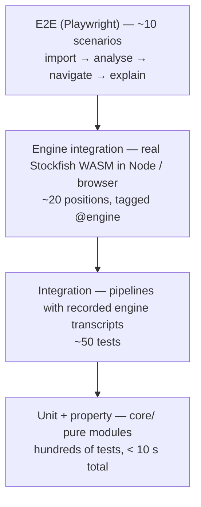

# Testing Strategy

| | |
|---|---|
| Status | Draft v0.2 — Phase 0, revised after owner review |
| Date | 2026-11-03 |
| Principle | We test the **chess analysis**, not just whether the UI looks right. An analysis bug is worse than a crash, because nobody notices it. |

---

## 1. Tooling

| Purpose | Tool |
|---|---|
| Unit and integration tests | **Vitest** (Node environment for `core/`, jsdom for hooks) |
| Property-based tests | **fast-check** |
| Network mocking (Chess.com, LLMs) | **MSW** (Mock Service Worker) with recorded fixtures |
| Browser and end-to-end tests, real workers and WASM | **Playwright** (Chromium and Firefox) |
| Type safety | `tsc --noEmit` in strict mode (TypeScript 6.0, pinned; architecture D0) |
| Lint | ESLint with an import-boundary rule: `core/` may not import React, the DOM or `infra/` |
| Coverage | Vitest V8 coverage. Thresholds enforced for `src/core/` and, from Phase 2 (decision D14), `src/infra/engine/`: ≥ 90% lines and ≥ 85% branches. |
| Real engine | Vitest project `engine` (`npm run test:engine`) runs the pinned npm Stockfish build as a Node child process (`tests/engine/nodeTransport.ts`). The default `unit` project (`npm test`) never starts an engine. |
| Engine test double | `tests/helpers/fakeEngine.ts` (`FakeEngine`): a scripted UCI engine for unit tests of `EngineWorker` and `EnginePool`. It is used in tests only. |
| Dependency licences | A script checks every runtime dependency's licence against an allow-list (MIT, BSD, Apache-2.0, ISC, GPL-3.0, CC0) |

CI-style command: `npm run check` runs typecheck, lint, licence check, unit tests (with coverage thresholds), then integration tests. `npm run test:e2e` and `npm run test:engine` are separate because they are slower. All of them run on Node 24 LTS.

## 2. Test pyramid

The key enabler is **recorded engine transcripts**. A script runs real Stockfish once on fixture games and saves the raw UCI output. Most tests then replay those transcripts, so they are fast and deterministic, and they don't need the engine.

## 3. Fixtures

| Fixture set | Contents | Source |
|---|---|---|
| `pgn/rules/` | Castling both sides, castling rights lost, en passant, all four promotions, underpromotion with check, checkmate, stalemate, insufficient material, threefold repetition, 50-move rule, custom-FEN start with Black to move | Hand-built |
| `pgn/chesscom/` | 23 real Chess.com PGNs (6 bullet, 8 blitz, 5 rapid, 4 daily), all with `%clk`. Endings: checkmate, resignation, timeout, abandonment, stalemate, insufficient material, repetition, the 50-move rule, agreement. | Public games recorded with `scripts/fetch-chesscom-fixtures.mjs`, then **pseudonymised** by `scripts/anonymise-fixtures.mjs`: every player except the public account `hikaru` becomes `player-NN`, and game links and UUIDs are replaced with synthetic values. Moves, clocks and results are unchanged. The owner's own games can be added the same way. |
| `pgn/malformed/` | Illegal move, unreadable SAN, truncated movetext, unterminated comment, unsupported variant, invalid FEN tag, unbalanced `(`/`)`, malformed tag. Every file must produce exactly one located error. | Hand-built |
| `pgn/edge-cases/` | Valid but awkward input: BOM + CRLF, a multi-game file with comments, NAGs, nested variations, an escape line and one broken game | Hand-built |
| `engine/positions.json` + `engine/transcripts/` | 12 positions (equal, material advantage, mate for and against each side, forced moves, repetition with and without move history), each with both sides to move where relevant. Every line from `go` to `bestmove` is recorded at Quick (MultiPV 1) and Standard (MultiPV 2): 24 `.uci` files, each with a header naming the engine and the exact commands. Expected values in the tests were read by hand from the raw files. | `npm run record:engine` (`scripts/record-engine-fixtures.mjs`, the npm build in Node, decision A13). `npm run record:engine -- --verify` re-runs every search and confirms identical output (ignoring `nps`/`time`). |
| `lichess-evals/` | 50 games already analysed on Lichess, exported **with Lichess's evals and accuracies** | Lichess game export API (verify parameters when building) |
| `classify/positions/` | Positions with known correct labels: an obvious blunder, a missed mate, a Great only-move, textbook Brilliant sacrifices (positive) and plain trades or desperado captures (negative) | Hand-curated |
| `coach/golden/` | About 30 `CoachFacts` moments, plus adversarial model outputs | Hand-built |
| `chesscom/api/` | Recorded API responses: profile, archives, a month, 404, 410, 429, and an empty month | Recorded once with `curl`, then frozen |

## 4. Test areas

### 4.1 Chess logic (`core/chess`, `core/pgn`)
- Legal and illegal moves rejected with a precise error location.
- Castling (both sides, through check, after the rook has moved), en passant (only on the immediately following move), promotions (including SAN `=N+`), checkmate, stalemate, and every draw rule, all detected as `terminal` correctly.
- Repetition detection uses the move history, not the FEN alone.
- PGN round trip: parse → export → parse gives the same plies. `%clk` is extracted correctly, including `h:mm:ss.s` with fractional seconds.
- SAN↔UCI conversion for castling (`O-O` ↔ `e1g1`) and promotions.

### 4.2 Evaluation and perspective (`core/eval`) — highest priority
- **Perspective unit tests:** a side-to-move score with Black to move is negated, for both cp and mate.
- **Mirror property (fast-check):** for random legal positions with a synthetic score, colour-flipping the position (mirror the ranks, swap the colours, negate the score) gives the same mover-POV Win%, label and accuracy.
- **Monotonicity:** Win% strictly increases with cp, and accuracy strictly decreases with loss.
- **Bounds:** Win% ∈ [0, 100]; accuracy ∈ [0, 100]; clamping at ±1000 cp.
- **Mate mapping:** mate for the mover → 97.54; mate against → 2.46; checkmated side to move → 2.46 for it and 97.54 for the winner; a terminal draw → 50 (our rule).
- **Mate rules (§5.4):** the boundary values −1000, −700, +700, +1000 on each side, and the three rules never firing for the same move.
- **Reference table:** the values in methodology §4.1 and §6.1, to 0.1 precision.

### 4.3 UCI parsing (`infra/engine/uci-parser`)
- Parses `info` lines with every field in any order, including `wdl`, `hashfull` and `currmove` (ignored).
- Discards `lowerbound`/`upperbound` lines.
- Picks the deepest completed line for each `multipv`.
- `bestmove (none)`, `bestmove e7e8q ponder …`.
- Garbage lines are ignored without throwing.

### 4.4 Engine integration (`@engine`, real WASM)
- The worker boots: `uci` → `uciok`, `isready` → `readyok` within the timeout.
- **FEN loading:** after `position fen X`, the engine's `d` command output (where supported) matches X. Otherwise, a known position returns its known best move: mate-in-1 positions must return the mating move at every preset.
- **Evaluation sign:** a position where White is a queen up returns a positive score for both White-to-move and Black-to-move after normalisation.
- **Mate scores:** a mate-in-2 position returns `mate` with the correct sign and distance.
- **Determinism:** the same position and the same preset run twice with a fresh hash give identical best move and score.
- **Lifecycle:** cancel mid-search → `stop` → `bestmove` → worker returns to Ready. Killing a worker mid-job makes the pool respawn it, and the job is retried once and then marked `failed`.
- **Pool:** N jobs over M workers finish with all results present and correctly indexed (no off-by-one between position index and ply).

### 4.5 Classification and accuracy (`core/classify`, `core/accuracy`)
- One table-driven test per row of methodology §5.3 and §5.4: synthetic before/after scores produce the expected label.
- Miss: positive case (opponent blundered, the user didn't punish) and negative cases (the opponent's mistake was small; the user's move was only an inaccuracy).
- Great: positive (only move, gap ≥ 10), and negatives (obvious recapture; king out of check with 2 legal moves; position already decided; no MultiPV data → not evaluated).
- Brilliant: curated positives and negatives, plus **"omit when unknown"** (a PV that is too short gives no label).
- Forced: excluded from accuracy by default, included in `lichessCompat`. A test asserts that excluding Forced moves leaves every other move's **weight** unchanged, because windows are always built over the full series.

**Lichess-compatibility tests**, in three layers, all run in `lichessCompat` mode:

1. **Ported Lichess unit vectors.** These are the scenarios from lila's `AccuracyPercentTest.scala`, re-expressed as our own table tests (facts, not copied code), with Lichess's tolerances:
   - an empty game and a single move → undefined;
   - two good moves → 100/100 ±1;
   - a White blunder on move 1 → ≈10 ±5 / 100 ±1;
   - 20 perfect moves plus one blunder → ≈50 ±5;
   - 5 and 50 "average" moves (65 cpl) → ≈76 ±8;
   - 50 mediocre moves (150 cpl) → ≈54 ±8;
   - 50 terrible moves (500 cpl) → ≈20 ±8;
   - the Black-to-move-first variants;
   - phase accuracy using the previous phase's eval.

   They all use the legacy initial eval (cp +15) as Lichess does. During Phase 0 a throwaway reference implementation of methodology §6.2 passed all of the non-phase vectors. The TypeScript implementation must pass all of them.
2. **Algorithm edge-case tests** (our own):
   - window size at n = 19, 20, 29, 80, 81 and 200 plies (giving 2, 2, 2, 8, 8 and 8);
   - the lead windows and trailing windows, asserted move by move on a 25-ply series;
   - population (not sample) standard deviation;
   - weight clamping at 0.5 and 12;
   - the harmonic mean with a 0% move (the floor of 1 applies);
   - a missing eval in the middle, at the first position and at the last position: exactly the right moves are dropped (§6.4);
   - a game starting with Black to move;
   - mate scores and terminal positions mapping to the ceiling.
3. **Cross-check against real Lichess games (the most important accuracy test).** For each of the 50 `lichess-evals` games:
   1. feed **Lichess's own per-ply evals** into our accuracy function. Use the initial-position eval if the export provides it, otherwise cp +15, which is what Lichess itself does for those analyses;
   2. assert that our White and Black accuracy, **rounded to integers** (as Lichess displays them), are each within **±1** of Lichess's reported accuracy;
   3. where our per-player result is undefined, Lichess's must be undefined too. Lichess returns no accuracy for either player if one of them has no counted moves; the comparison accounts for that.

   This proves the formula and aggregation are implemented exactly, independent of engine differences. The export parameters (`evals`, `accuracy`) are to be confirmed against the Lichess API documentation when the fixtures are collected in Phase 3.
- **ACPL:** checked against Lichess's reported ACPL for the same 50 games, ±1.
- **Sanity correlation (report, not a gate).** For Chess.com games that include `accuracies`, compute the Pearson correlation between our accuracy (Standard preset) and Chess.com's. We expect a strong positive correlation, and the result is recorded in the docs. A weak correlation is investigated, but it is not "fixed" by tuning toward a proprietary number.
- **Regression snapshots:** `GameReview` for 10 fixture games with recorded transcripts is snapshot-tested. Any methodology change must update the snapshots **and** bump the version.

### 4.6 Phases and motifs
- Phase boundaries on fixture games where the expected boundaries were annotated by hand. Miniatures that never reach an endgame.
- For every motif: at least 2 positive and 2 negative positions. Detectors must return nothing when their inputs (PV, clocks) are missing.

### 4.7 Chess.com client
- Username validation (case, illegal characters, length).
- 404 → "not found". 410 → "permanently unavailable". 429 → backoff (2 s, 4 s, 8 s) then a friendly error. Offline → "couldn't reach Chess.com".
- **Caching** (architecture §7):
  - a past month is requested once, and a second request is served from the app cache with no network call;
  - the current month and the archive list are requested with `cache: "no-cache"`, so the browser revalidates them.
- **Serial queue:** no two requests are in flight at once (asserted through MSW timing, and again in E2E through Playwright routing).
- Non-standard `rules` games are listed but marked not analysable. Missing optional fields don't break parsing. A malformed game entry is skipped and counted, without failing the whole month.
- **Live check (manual, real API):** `LIVE_CHESSCOM_USER=<name> npm run test:live`. It imports the 10 most recent games, replays every move independently, and compares the final position with Chess.com's `CurrentPosition`.

### 4.8 AI coach
- **Provider adapter, Gemini only in Phase 4** (MSW): request shape (schema attached, key header, model), usage parsing, timeout → abort, 429 retry with `Retry-After`, 401 → no retry, mapping of vendor errors onto the shared error taxonomy. These contract tests are written against `LLMProvider`, so the deferred Claude and OpenAI adapters (Phase 4b) can reuse them unchanged.
- **Move catalogue builder:** every catalogue entry replays legally from its position with chess.js. Ids follow the grammar (`P`, `B1…`, `A1`, `R1…`, `k<ply>.P`). SAN and UCI agree, including castling and promotions.
- **Validator** (AI_COACH_DESIGN §7.2). It must **reject**:
  - an unknown `[[m:ID]]`;
  - a malformed token;
  - an invalid `[[sq:i9]]`;
  - untokenised notation: `Qxf7#`, `O-O`, `0-0-0`, `exd5`, `e8=Q`, `e4+`, `12.Nf3`, `12...e5`;
  - "you should play e5";
  - a `keyMoves` role mismatch;
  - a fabricated evaluation ("+2.3", "60%", "cp");
  - a ply that wasn't supplied;
  - a motif that wasn't supplied;
  - a Blunder described as "a great move";
  - invalid JSON;
  - a truncated response.
- It must **accept**:
  - square-heavy prose ("the knight forks [[sq:f7]] and h7", "your c3 knight", "the f-file");
  - move numbers ("on move 23");
  - tokens next to punctuation ("[[m:B1]]!", "([[m:R1]])");
  - words that resemble notation but aren't ("Be careful", "Na", "Qa" without a square).
- A test documents the known limitations (§7.3) as **expected passes**: a semantically false claim about a valid token is accepted by the validator. This keeps the limitation visible rather than implied.
- **Fallback:** when validation fails twice, the template explanation is shown and nothing crashes.
- **Caching:** the same facts, model and level → no second network call.
- **Privacy:** a snapshot of the outgoing request body contains no usernames (default setting), no PGN headers, and no API key.
- **Live golden-set evaluation** (manual, uses a real key): `npm run eval:coach -- --provider gemini`. It reports the first-try validator pass rate, the rejection reasons, latency and tokens, and it produces a sheet for the owner's by-hand incorrect-claim rating. It is never part of the automated suite.

### 4.8b Storage (Phase 2, Stage 3)
- **Repositories:** run against both `fake-indexeddb` and the in-memory fallback, which must behave identically. Covered:
  - save and read back;
  - no duplicate on re-import (createdAt kept, analyses stay linked);
  - newest-first listing;
  - presets never colliding;
  - merges that never lose or downgrade a result;
  - returned copies that can't change stored data.
- **IndexedDB only:**
  - data survives a close and reopen (a reload);
  - invalid records are reported, skipped and never overwritten;
  - bad cached months are ignored and left in place;
  - failures are classified (quota, unavailable, closed, blocked).
- **Storage service and games store:**
  - fallback to memory with the right banner message;
  - `persist()` is asked once and its answer recorded;
  - games are kept in memory when saving fails;
  - games load after a reload, and unknown ids are marked missing.
- **Analysis controller:**
  - throttled saves (fewer than one per result, always a final one);
  - resume after a reload, where only unanalysed positions are searched;
  - reuse of a complete analysis;
  - preset isolation;
  - a new run cancels the old one;
  - the cross-tab lock;
  - saving failures continue in memory;
  - an unreadable stored analysis is never written over.
- **E2E** (`tests/e2e/persistence.spec.ts`, a real browser reload):
  - an imported game survives a reload;
  - no duplicate on re-import;
  - a past Chess.com month is not refetched after a reload;
  - with IndexedDB disabled, the banner appears and import and review still work.
- **Resume after a reload with a real browser engine** needs the Stage 4 debug view to start an analysis. Until then it is tested at controller level with a reopened database.

### 4.9 UI and E2E (Playwright)
1. Paste a PGN, analyse with Quick, and every move gets a label. The eval graph has n+1 points.
2. Keyboard navigation (← → Home End) updates the board, the eval bar, the highlighted move and the coach panel.
3. Clicking a point on the graph jumps to that ply.
4. Chess.com import with MSW: username → months → games → import → analyse.
5. Cancel analysis mid-way, then resume, and only the missing positions are analysed.
6. Reload the page: the analysis is loaded from IndexedDB, and no engine work starts.
7. With no API key, the coach shows template explanations. With a mocked key, it shows AI explanations.
8. Mobile viewport (375 px): no horizontal scroll, and the board is usable.
9. Accessibility smoke test (axe): no critical violations on Home and Review.
10. Retry a mistake: a wrong move gives feedback, the correct move is accepted, and the SRS schedule updates.

**Implemented in Phase 2** (`tests/e2e/analysis.spec.ts`, real engine in browser Workers), covering items 2, 5 and 6 for the debug view:
- a whole game analysed with the raw evaluation per position, mate shown as `M1` and the final checkmate resolved by rules;
- keyboard navigation while analysis runs;
- stop, then a reload: the saved progress is shown, and resuming continues from it;
- a complete saved analysis reused with no engine work;
- presets kept apart;
- analysis in memory when IndexedDB is unavailable;
- **no main-thread long task over 50 ms** during a whole-game analysis. A deliberate 120 ms control task proves the observer works; a busy loop run directly by `page.evaluate` is not reported as a long task, so the control runs inside `setTimeout`.

## 5. Benchmarks (not tests, but tracked)

Implemented in Phase 2 as a Playwright spec (decision D9), because Workers and long tasks need a real browser: `npm run bench` (`tests/benchmark/benchmark.spec.ts`, `playwright.bench.config.ts`). Each run uses a fresh browser context. It measures:
- engine start time;
- p50/p95/max time per position by preset;
- whole-game wall time by engine count (1–4);
- long tasks;
- memory per engine (approximate, renderer private bytes);
- IndexedDB read/write time;
- a CPU-throttled run, which only slows the main thread, not workers (see BENCHMARKS §2.6).

`npm run bench:builds` (`scripts/benchmark-engine-builds.mjs`) compares the lite and full engine builds in Node for decision U4.

Raw results are committed in `docs/benchmarks/*.json`. The summary is in `docs/BENCHMARKS.md`, which is the **only** source for any timing shown in the UI or the docs.

## 6. Definition of done for analysis features

A change to `core/eval`, `core/classify` or `core/accuracy` is done only when:

1. Its unit, property and table tests pass.
2. The Lichess cross-check passes.
3. The regression snapshots are unchanged, or are updated with a methodology version bump and a changelog entry.
4. The methodology document matches the code (the constants are referenced from a single config).

## 7. Acceptance status

Every acceptance criterion in the roadmap is recorded with exactly one status:

| Status | Meaning |
|---|---|
| **PASS** | Verified by running the stated check. The evidence (command, counts) is recorded. |
| **BLOCKED — ENVIRONMENT** | The check could not run because of the machine or environment, not the code. The exact error, the environment and the remedies tried are recorded, along with a follow-up to run it elsewhere. This is **never** counted as a pass. |
| **PENDING** | The check has not run yet, usually because it needs input from the owner. It is listed as a follow-up. |
| **FAIL** | The check ran and did not meet the criterion. |

A phase is **fully accepted** only when every criterion is PASS. With any BLOCKED or PENDING criterion, the owner may grant **conditional acceptance**, which keeps the follow-ups open.

A substitute check doesn't change a status unless the owner agrees in advance. For example, a WebKit run does not stand in for Firefox, and a test on another player's account does not stand in for a test on the owner's account.

### Phase 1 (2026-11-03): conditionally accepted

| Check | Status | Result |
|---|---|---|
| `npm run check`: typecheck, lint, licences, unit + integration tests with coverage | PASS | **241 tests passing** in 7 files. Coverage of `core/`: lines 99.72%, branches 95.95%. |
| E2E, Chromium | PASS | **30/30** |
| E2E, Firefox | **BLOCKED — ENVIRONMENT** | Playwright Firefox can't launch on Windows build 10.0.26300: a side-by-side error, *dependent assembly `mozglue` could not be found*, and the same after `npx playwright install --force firefox`. No Firefox test ran. Follow-up F1 (another machine or CI). *Update 2026-11-11: F1 closed; Firefox passes in CI on Ubuntu and Windows.* |
| Live check, owner's 10 most recent Chess.com games | **PENDING** | Needs the owner's username. A run on the public account `hikaru` passed 10/10. That shows the import works on real data, but it doesn't satisfy this criterion. Follow-up F2. |

The full criterion-by-criterion record is in [DEVELOPMENT_ROADMAP §3](DEVELOPMENT_ROADMAP.md#phase-1-acceptance-record-2026-11-03).
